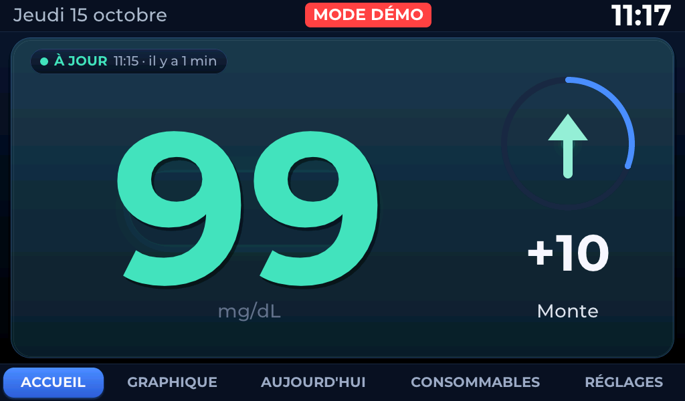

# Dexcom G7 family glucose display — Waveshare ESP32‑P4 7″

> ⚠️ **Experimental personal project. This project is not certified for medical use.**
> It must not be used for treatment decisions and does not replace the official Dexcom
> application, its alarms, or any certified monitoring system.

Developer documentation is maintained in English; on-device languages are unchanged.

A permanent wall display showing a Dexcom G7 reading large enough to be read from several
metres away: value, trend arrow, change since the previous reading, data age, 24 h chart,
daily statistics, consumable tracking and spoken alerts in six languages.

Data path: G7 sensor → phone → **Dexcom Share** servers → Internet → display.
The device never talks to the sensor directly.



**Initiated and directed by Mohamed-Razine Zerdoum.** Hardware: **Waveshare ESP32-P4-WIFI6-Touch-LCD-7B**
(7″ touch display, 1024 × 600), microSD card, speaker. Code under the MIT licence; third-party
components keep their own authors and licences.

### Where to start

| I want to… | Go to |
|---|---|
| 🔧 **Set up the device** | [Beginner's tutorial](docs/BEGINNER_TUTORIAL_EN.md) — buy, connect, install, configure |
| ⬇️ **Download the programs** | [Releases](../../releases) — firmware, Windows app and checksums (voice banks are separate) |
| 🔊 **Prepare the microSD** | [Voice tutorial](docs/VOICE_TUTORIAL_EN.md) — optional six-language banks, including how to generate your own |
| 🧩 **Understand the code** | [Developer walkthrough](docs/DEVELOPER_WALKTHROUGH.md) · [Code guide](docs/CODE_GUIDE_EN.md) |

> **Not yet tried end to end on a brand-new device.** Installation, update, reconnection,
> announcements and the setup wizard were verified on the author's own device; first-time setup of
> a blank device (entering new credentials, saving, restarting) has only been validated in
> simulation. See [docs/LIMITATIONS_EN.md](docs/LIMITATIONS_EN.md).

*Real screenshot taken from the board, in demo mode (fictitious data).*

---

## Features

- **Glucose** — Dexcom Share (European “OUS” account), one reading every 5 minutes, value in
  mg/dL at 320 px, trend arrow, delta, data age (fresh < 6 min, late 6–10 min, stale ≥ 10 min).
- **History** — 288 readings in RAM (24 h), 3 h / 6 h / 12 h / 24 h chart with touch
  inspection, daily CSV on microSD, back‑fill of late readings, gap‑tolerant resume.
- **Today** — time in range, average, min, max, coverage, time low/high, low/high episodes.
- **Consumables** — G7 sensor: due = insertion + exactly 10 days, reminders 24 h and 2 h
  before. Infusion set: 48 h or 72 h, single reminder 2 h before. Dates and reminders are
  stored in NVS across normal reboots and rebuilds; a memory failure may require restoring a backup. Local stock count
  per item, never negative, decremented once per change.
- **Alerts** — urgent‑low / low / high / urgent‑high thresholds (55 / 70 / 250 / 300 mg/dL by
  default, adjustable), “no data” alert, rising volume while a critical alert is unacknowledged,
  urgent‑low audible even when muted, on‑screen panel, repetition guard.
- **Voice** — announcements played from a WAV bank on the microSD, one per language, falling
  back to a beep. Alert sounds always work, with or without a bank. Local voice *commands* are
  **not part of the shipped build** (see Limitations); every action is reachable by touch.
- **Language** — interface **and spoken announcements** in **6 languages** (French, English, Spanish,
  German, Italian, Portuguese), selectable in the settings page, applied immediately and stored in
  NVS. Each language has its own speech bank on the microSD, in the same voice; if one is missing,
  the French bank takes over.
- **Night mode** — simplified night screen on a schedule, reduced brightness, a touch brings
  the normal interface back for 30 s, alerts still take priority.
- **System** — Wi‑Fi through the ESP32‑C6 co‑processor (ESP‑Hosted) with reconnection, SNTP
  time with the French timezone, FAT32 microSD that is never auto‑formatted, persistent
  settings, task watchdog.
- **Setup without rebuilding** — on first start a touchscreen wizard asks for the language, the
  Wi‑Fi network and password, the Dexcom Share account and region, **tries the connection**, and
  stores the credentials only after success and confirmation: working credentials are never
  replaced by invalid ones. Everything can be changed later in SETTINGS → CONNECTION, or from the
  PC with the `GlycemieConnexion.exe` Windows app over USB.
- **Demo mode** — a button in the wizard, a switch in the settings, or
  `demo normal|low|verylow|high|veryhigh|gap|stale` on the serial console: 24 h of **fictitious**
  data with a “MODE DÉMO” banner, so the device can be installed and tried **without a Dexcom
  account**.

Five pages only: home, chart, today, consumables and settings.

---

## Hardware

- Waveshare ESP32‑P4‑WIFI6‑Touch‑LCD‑7B
  ([docs](https://docs.waveshare.com/ESP32-P4-WIFI6-Touch-LCD-7B) ·
  [repo](https://github.com/waveshareteam/ESP32-P4-WIFI6-Touch-LCD-7B))
- ESP32‑P4 **rev 1.3** — the pre‑v3 profile is mandatory (`config/esp32p4_rev1_3.defaults`);
  `main/CMakeLists.txt` refuses to build a configuration resolved as rev 3.x
- 7″ 1024 × 600 MIPI‑DSI (EK79007), GT911 touch, 32 MB flash, 32 MB PSRAM
- ESP32‑C6 Wi‑Fi co‑processor, ES8311 audio, microSD, USB‑C with a CH343 USB‑UART bridge

## Software stack (pinned)

ESP‑IDF 5.5.5 · Waveshare BSP 3.0.1 · LVGL 9.5.0 · esp_wifi_remote 1.2.5 ·
esp_hosted 1.4.x · ESP‑SR 2.5.3. Resolved versions are committed in `dependencies.lock`.

---

## Build

**For a ready-to-install device**, follow the [beginner's tutorial](docs/BEGINNER_TUTORIAL_EN.md). The public firmware is configured after installation, on the touchscreen or with the Windows application; it does not require personal credentials compiled into the source.

**Developers** can build the firmware from source with ESP-IDF 5.5.5. See the [technical installation instructions](docs/INSTALLATION_EN.md):

```powershell
git clone https://github.com/ZerdoumRazine/Waveshare-Glycemie.git waveshare-glycemie
cd waveshare-glycemie
idf.py set-target esp32p4
idf.py build
```

Keep the project path and ESP-IDF tools in paths without accents. A legacy source-level credentials option remains available for private builds, but never distribute a binary containing your own credentials.

## Tests

```bash
python tests\run_tests.py           # host unit tests (gcc, clang or MSVC Build Tools)
python tests\test_langues_voix.py   # consistency of the six speech banks
python tests\test_depot.py          # repository consistency and no-private-data checks
python tools\verif_avant_flash.py   # 23 checks on the built image, before flashing
```

The host tests compile the real firmware sources (`glucose_math.c`, `app_state.c`,
`sensor_session.c`, `consumables.c`, `stock.c`); only NVS, FreeRTOS, microSD and network are
replaced by stubs.

---

## Documentation

Developer comments and documentation are maintained in **English**. The display and
voice announcements still support six languages. The optional Windows USB setup
application currently uses French labels; its English tutorial explains them.

| Guide | Purpose |
|---|---|
| [Beginner's tutorial](docs/BEGINNER_TUTORIAL_EN.md) | Hardware, flashing, setup and first use |
| [Developer walkthrough](docs/DEVELOPER_WALKTHROUGH.md) | Step-by-step explanation of firmware startup, services, interfaces, tests and design decisions |
| [Code guide](docs/CODE_GUIDE_EN.md) | Module responsibilities and how to make safe changes |
| [Architecture](docs/ARCHITECTURE_EN.md) | Components, state, data flows and fault handling |
| [Dexcom setup](docs/DEXCOM_SETUP_EN.md) | Account connection and credential safety |
| [Voice tutorial](docs/VOICE_TUTORIAL_EN.md) | Six-language speech banks and microSD installation |
| [Installation](docs/INSTALLATION_EN.md) | Building with ESP-IDF and installing firmware |
| [Recovery and rollback](docs/RECOVERY_EN.md) · [Rollback guide](docs/ROLLBACK_EN.md) | Backup, recovery and undoing an update |
| [Troubleshooting](docs/TROUBLESHOOTING_EN.md) | Diagnosing common faults |
| [Limitations](docs/LIMITATIONS_EN.md) | Known constraints and untested scenarios |

---

## Licence

The project's original code is released under the **MIT licence** (see [LICENSE](LICENSE)). Project initiated and led by **Mohamed-Razine Zerdoum** — [Credits](CREDITS.md). Third-party components retain their authors and applicable licences: [third-party licences](docs/THIRD_PARTY_LICENSES_EN.md).

This is an experimental supplementary display, not certified for medical use. It can report delayed or incorrect readings and must never replace official glucose monitoring, alerts, or treatment guidance.
