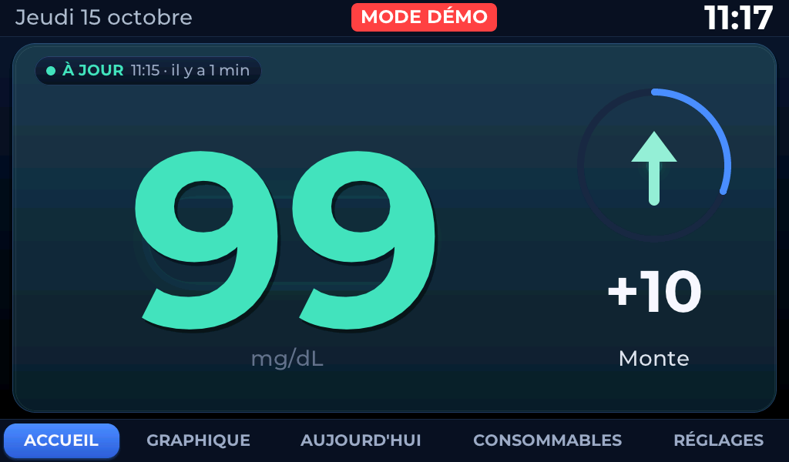
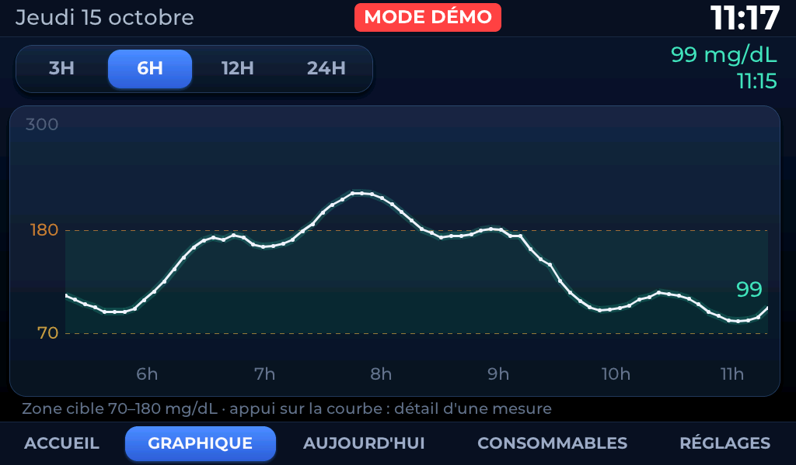
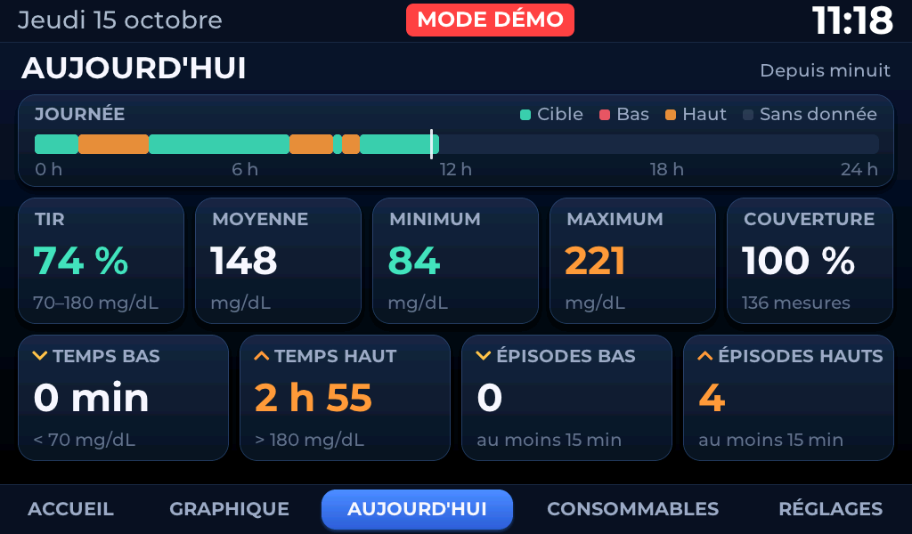
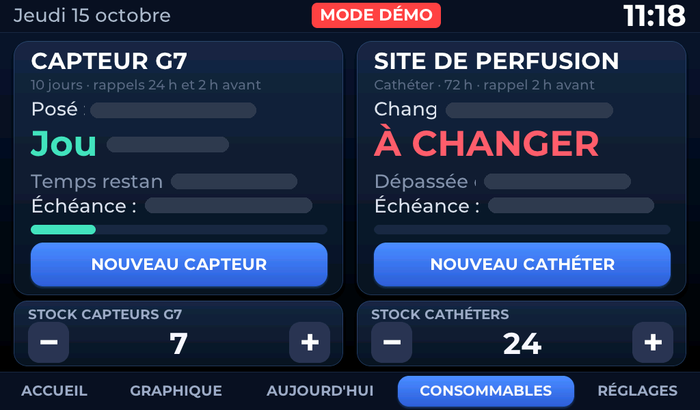
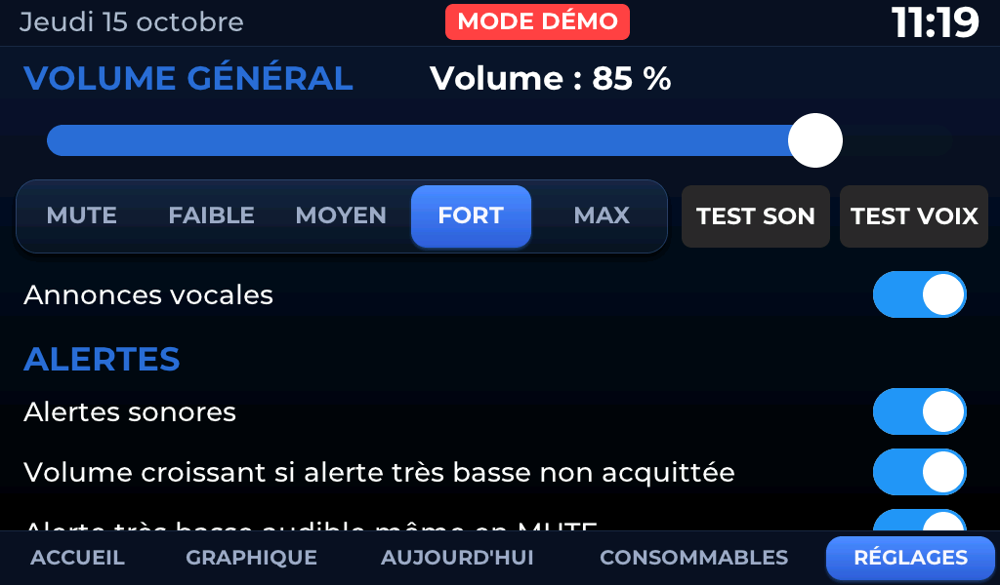

# Afficheur familial de glycémie Dexcom G7 — Waveshare ESP32‑P4 7″

> ⚠️ **Projet personnel expérimental, non certifié pour un usage médical.**
> Il ne doit servir à aucune décision thérapeutique et ne remplace **ni** l'application
> Dexcom officielle, **ni** ses alarmes, **ni** aucun système de surveillance certifié.
> Les alarmes de référence restent celles du téléphone et du capteur.

Afficheur mural permanent qui montre, lisible à plusieurs mètres, la glycémie d'un
capteur Dexcom G7 : valeur, flèche de tendance, variation, âge de la donnée, courbe,
statistiques du jour, suivi des consommables et annonces parlées en six langues.

La chaîne est : capteur G7 → téléphone → serveurs **Dexcom Share** → Internet → écran.
L'appareil ne communique **jamais** directement avec le capteur.



*Capture réelle de la carte, en mode démonstration (données fictives).*

**Projet initié et dirigé par Mohamed-Razine Zerdoum.** Matériel : **Waveshare ESP32-P4-WIFI6-Touch-LCD-7B**
(écran tactile 7″, 1024 × 600), microSD, haut-parleur. Code sous licence MIT ; les composants
tiers gardent leurs auteurs et leurs licences.

### Par où commencer

| Je veux… | Aller à |
|---|---|
| 🔧 **Installer l'appareil** | [Tutoriel pour débuter](docs/TUTORIEL_DEBUTANT_FR.md) — acheter, brancher, installer, configurer |
| ⬇️ **Télécharger les programmes** | [Releases](../../releases) — firmware, application Windows et fichiers d'intégrité (banques vocales en ressources séparées) |
| 🔊 **Préparer la microSD** | [Tutoriel des voix](docs/TUTORIEL_VOIX_FR.md) — créer ou installer les banques optionnelles, avec ou sans lecteur de carte |
| 🧩 **Comprendre le code** | [Architecture](docs/ARCHITECTURE_FR.md) et le dossier [`main/`](main/) |

> **Pas encore essayé de bout en bout sur un appareil neuf.** L'installation, la mise à jour, la
> reconnexion, les annonces et l'assistant de connexion ont été vérifiés sur l'appareil de
> l'auteur ; la première configuration d'un appareil vierge (saisie de nouveaux identifiants,
> enregistrement, redémarrage) n'a été validée qu'en simulation. Voir
> [docs/LIMITATIONS_FR.md](docs/LIMITATIONS_FR.md).

---

## Sommaire

- [Ce que fait l'appareil](#ce-que-fait-lappareil)
- [Les cinq pages](#les-cinq-pages)
- [Matériel](#matériel)
- [Installation rapide](#installation-rapide)
- [Configuration](#configuration)
- [Structure du dépôt](#structure-du-dépôt)
- [Tests](#tests)
- [Documentation détaillée](#documentation-détaillée)
- [Limites connues](#limites-connues)
- [Licence et crédits](#licence-et-crédits)

---

## Ce que fait l'appareil

| Domaine | Fonctions |
|---|---|
| **Glycémie** | Lecture Dexcom Share (compte européen « OUS »), une mesure toutes les 5 min, valeur en mg/dL en 320 px, flèche de tendance, variation depuis la mesure précédente, âge de la donnée (À JOUR < 6 min, RETARD 6–10 min, DONNÉES ANCIENNES ≥ 10 min) |
| **Historique** | 288 mesures en mémoire (24 h), courbe 3 h / 6 h / 12 h / 24 h, exploration tactile point par point, enregistrement CSV quotidien sur microSD, rattrapage des mesures publiées en retard, reprise après coupure réseau sans doublon |
| **Statistiques** | Page AUJOURD'HUI depuis minuit : temps dans la cible, moyenne, minimum, maximum, couverture, temps bas / haut, épisodes bas / hauts, frise de la journée |
| **Consommables** | Capteur G7 : échéance = pose + 10 jours exactement, rappels 24 h et 2 h avant. Cathéter : intervalle 48 h ou 72 h, rappel unique 2 h avant. Dates et rappels conservés en NVS lors des redémarrages et mises à jour normales ; une défaillance de mémoire peut nécessiter une restauration depuis sauvegarde. Stock local par consommable, jamais négatif, décrémenté une seule fois par changement |
| **Alertes** | Seuils très basse / basse / haute / très haute (55 / 70 / 250 / 300 mg/dL par défaut, réglables), alerte « aucune donnée », volume croissant si une alerte critique n'est pas acquittée, alerte très basse audible même en sourdine, panneau à l'écran, anti‑répétition |
| **Voix** | Annonces lues depuis la microSD (banque de fichiers WAV par langue), repli sur la banque française si la langue manque, puis sur un bip. Installation pas à pas : [docs/TUTORIEL_VOIX_FR.md](docs/TUTORIEL_VOIX_FR.md). Les **alertes sonores** fonctionnent toujours, même sans banque vocale |
| **Mode nuit** | Écran nuit simplifié selon un horaire (22:00–07:00 par défaut), luminosité réduite, un toucher rend l'interface normale 30 s, les alertes restent prioritaires |
| **Langue** | Interface **et voix** en **6 langues** : français, anglais, espagnol, allemand, italien, portugais. Choix dans RÉGLAGES, appliqué immédiatement et conservé en NVS. Chaque langue a sa banque vocale sur la microSD (même timbre partout) ; si celle d'une langue manque, la voix française prend le relais. Toutes les actions sont accessibles **au toucher** |
| **Système** | Wi‑Fi via le coprocesseur ESP32‑C6 (ESP‑Hosted) avec reconnexion, heure SNTP et fuseau français, microSD FAT32 jamais formatée automatiquement, réglages persistants, surveillance par chien de garde |
| **Démonstration** | `demo normal | low | verylow | high | veryhigh | gap | stale` en console : 24 h de données **fictives**, bandeau « MODE DÉMO » à l'écran, aucune écriture sur la microSD. Permet d'installer et d'essayer l'appareil **sans compte Dexcom** |

---

## Les cinq pages

| | |
|---|---|
| **ACCUEIL** — une seule grande carte, valeur 320 px, anneau de fraîcheur, flèche, variation |  |
| **GRAPHIQUE** — courbe 3 h à 24 h, appui sur la courbe pour lire une mesure |  |
| **AUJOURD'HUI** — statistiques depuis minuit |  |
| **CONSOMMABLES** — capteur G7, cathéter, stocks |  |
| **RÉGLAGES** — volume, voix, alertes, seuils, mode nuit, état des liaisons |  |

Toutes ces captures sont de **vraies captures** de la carte (commande console `snap`,
1024 × 600), prises en mode démonstration. Sur la page CONSOMMABLES, les dates réelles
de pose ont été masquées : ce sont des données personnelles.

Il n'y a **pas** de sixième page : une page STATS a existé puis a été retirée
volontairement (voir [docs/VERSIONS_FR.md](docs/VERSIONS_FR.md)).

---

## Matériel

- **Carte** : Waveshare ESP32‑P4‑WIFI6‑Touch‑LCD‑7B
  ([documentation](https://docs.waveshare.com/ESP32-P4-WIFI6-Touch-LCD-7B) ·
  [dépôt](https://github.com/waveshareteam/ESP32-P4-WIFI6-Touch-LCD-7B))
- **SoC** : ESP32‑P4 **révision v1.3** → le profil pré‑v3 est **obligatoire** (voir ci‑dessous)
- Écran 7″ 1024 × 600 MIPI‑DSI (EK79007), tactile GT911
- 32 Mo de flash, 32 Mo de PSRAM
- Wi‑Fi par coprocesseur ESP32‑C6 (le P4 n'a pas de radio)
- Audio ES8311 + amplificateur, microSD, USB‑C, pont USB‑série CH343

Détails et brochage : [docs/HARDWARE_FR.md](docs/HARDWARE_FR.md).

> **Révision de la puce.** Ce projet cible une carte **rev1.3**. `config/esp32p4_rev1_3.defaults`
> impose `CONFIG_ESP32P4_SELECTS_REV_LESS_V3=y` et `CONFIG_ESP32P4_REV_MIN_100=y`, et
> `main/CMakeLists.txt` refuse de compiler toute configuration résolue en rev3.x. Sur une
> carte plus récente, adaptez ce profil **en connaissance de cause**.

---

## Installation rapide

**Pour installer sans programmer :** suivez le [tutoriel illustré pour débutants](docs/TUTORIEL_DEBUTANT_FR.md). Il explique comment installer le programme, saisir ses propres accès Wi-Fi et Dexcom grâce à l'assistant tactile (ou l'application Windows), puis copier les sons sur microSD. Vous **n'avez pas besoin de modifier le code ni de recompiler pour renseigner vos accès**.

**Pour compiler depuis les sources :** suivez le [guide technique ESP-IDF](docs/INSTALLATION_FR.md). L'ancienne méthode permettant d'intégrer des identifiants au moment de la compilation y est documentée séparément ; elle ne doit jamais servir à produire des fichiers de distribution contenant des accès personnels.

> ⚠️ Le chemin utilisé pour compiler doit rester en caractères ASCII (sans accent).

---

## Configuration

**Depuis la version K22, personne n'a besoin de recompiler pour mettre ses identifiants.** Au
premier démarrage, un assistant tactile demande la langue, le réseau Wi‑Fi, son mot de passe, le
compte Dexcom et la région, puis **essaie la connexion** et n'enregistre qu'après réussite et
confirmation : des accès qui fonctionnent ne sont jamais remplacés par des accès invalides. Tout se
remodifie ensuite dans **RÉGLAGES → CONNEXION** (voir, modifier, effacer, mode démonstration).

Si la saisie au doigt est pénible, l'application Windows `GlycemieConnexion.exe`
(`tools/pc_app/`, à construire avec `tools\pc_app\construire_exe.ps1`) fait la même chose depuis le
PC par le câble USB, sans rien installer. Pas à pas :
[docs/TUTORIEL_DEBUTANT_FR.md](docs/TUTORIEL_DEBUTANT_FR.md).

Les mots de passe restent dans l'appareil (espace NVS `ident`, brouillés avec une clé dérivée de
l'adresse MAC), ne sont jamais journalisés ni affichés. **Ce brouillage n'est pas un chiffrement** :
le chiffrement matériel de la flash n'est pas activé, car il est irréversible.

### Identifiants compilés (ancienne méthode, toujours disponible)

Pour un appareil personnel, les identifiants peuvent encore venir de `private/device_secrets.h`,
un dossier ignoré par Git, compilé dans le firmware. Ils ne servent que si la mémoire `ident` est
vide :

```c
#define GLY_WIFI_SSID        ""       /* réseau Wi-Fi 2,4 GHz */
#define GLY_WIFI_PASSWORD    ""
#define GLY_DEXCOM_USERNAME  ""       /* compte Dexcom QUI PARTAGE (Share), pas un abonné */
#define GLY_DEXCOM_PASSWORD  ""
#define GLY_DEXCOM_REGION    "ous"    /* Europe : shareous1.dexcom.com */
```

Comme ces valeurs se retrouvent dans le binaire, **ne publiez jamais** le dossier `build/`
ni un fichier `.bin` compilé. Mise en place du partage Dexcom et pièges associés :
[docs/CONFIGURATION_DEXCOM_FR.md](docs/CONFIGURATION_DEXCOM_FR.md).

**Sans compte Dexcom**, l'appareil est utilisable immédiatement en mode démonstration :
branchez la console série et tapez `demo normal`.

---

## Structure du dépôt

```
CMakeLists.txt            projet ESP-IDF (racine)
sdkconfig.defaults        configuration du projet
config/                   profil de révision ESP32-P4 rev1.3 (ajouté en dernier)
partitions.csv            disposition identique au firmware d'origine + partition "model"
dependencies.lock         versions résolues des composants (reproductibilité)
main/                     tout le firmware (C) : Dexcom, réseau, microSD, audio, voix, interface
  fonts/                  Montserrat Medium et Bold (SIL OFL 1.1), embarquées
  voice/                  ancienne voix Windows embarquée, FACULTATIVE (console voice_old)
                          absente de la copie publiée : voir docs/LICENCES_TIERCES_FR.md
components/esp_driver_ppa correctif local d'un composant ESP-IDF (voir CORRECTIF.txt)
assets/                   manifeste de la banque vocale microSD
tools/                    environnement, compilation, vérification avant flash, capture série, voix
tests/                    tests unitaires sur PC + contrôles du dépôt
docs/                     documentation détaillée (français)
screenshots/              captures réelles des 5 pages
private/                  identifiants réels — ignoré par Git, jamais publié
```

---

## Tests

```bash
python tests\run_tests.py           # tests unitaires sur PC (gcc, clang ou Build Tools Visual Studio)
python tests\test_langues_voix.py   # cohérence des six banques vocales
python tests\test_depot.py          # cohérence du dépôt et absence de données privées
python tools\verif_avant_flash.py   # 23 contrôles sur le binaire compilé, avant tout flash
```

`tests\run_tests.py` compile le **vrai** code du firmware (`glucose_math.c`, `app_state.c`,
`sensor_session.c`, `consumables.c`, `stock.c`) ; seules la NVS, FreeRTOS, la microSD et le
réseau sont remplacés par des bouchons. Ce qui est couvert et ce qui ne l'est pas :
[tests/README_FR.md](tests/README_FR.md).

---

## Documentation détaillée

| Document | Contenu |
|---|---|
| [docs/TUTORIEL_DEBUTANT_FR.md](docs/TUTORIEL_DEBUTANT_FR.md) | **Débuter** : acheter, brancher, installer, configurer, copier les sons, tester, dépanner |
| [docs/BEGINNER_TUTORIAL_EN.md](docs/BEGINNER_TUTORIAL_EN.md) | Same beginner's guide, in English |
| [docs/RETOUR_ARRIERE_FR.md](docs/RETOUR_ARRIERE_FR.md) | Sauvegarder l'appareil, revenir en arrière, récupérer un écran qui ne démarre plus |
| [docs/COMMENT_PUBLIER_FR.md](docs/COMMENT_PUBLIER_FR.md) | Publier le projet sur GitHub, pièces jointes de Release |
| [docs/HARDWARE_FR.md](docs/HARDWARE_FR.md) | Carte, brochage, mémoire, port série |
| [docs/INSTALLATION_FR.md](docs/INSTALLATION_FR.md) | ESP‑IDF sur Windows, compilation, flash, microSD |
| [docs/CONFIGURATION_DEXCOM_FR.md](docs/CONFIGURATION_DEXCOM_FR.md) | Compte Share, région, verrou d'authentification |
| [docs/UTILISATION_FR.md](docs/UTILISATION_FR.md) | Les 5 pages, alertes, voix, mode nuit, consommables |
| [docs/TUTORIEL_VOIX_FR.md](docs/TUTORIEL_VOIX_FR.md) | **Annonces vocales** : installer une langue (10 min) ou fabriquer ses sons |
| [docs/VOICE_TUTORIAL_EN.md](docs/VOICE_TUTORIAL_EN.md) | Same voice guide, in English |
| [docs/ARCHITECTURE_FR.md](docs/ARCHITECTURE_FR.md) | Modules, tâches, mémoire, flux de données |
| [docs/DEPANNAGE_FR.md](docs/DEPANNAGE_FR.md) | Symptômes, causes, console série, FAQ |
| [docs/VERSIONS_FR.md](docs/VERSIONS_FR.md) | Historique des versions V1 → K19 |
| [docs/RECUPERATION_FR.md](docs/RECUPERATION_FR.md) | Comment ce dépôt a été reconstitué, et à partir de quoi |
| [docs/LIMITATIONS_FR.md](docs/LIMITATIONS_FR.md) | Ce qui n'est pas fait, pas testé, ou fragile |
| [docs/LICENCES_TIERCES_FR.md](docs/LICENCES_TIERCES_FR.md) | Licences des composants et ressources tierces |
| [docs/PUBLICATION_GITHUB_FR.md](docs/PUBLICATION_GITHUB_FR.md) | Vérifications avant de rendre le dépôt public |

---

## Limites connues

- Affichage **mg/dL uniquement** : la conversion en mmol/L n'est pas implémentée.
- Les **commandes vocales et l'écoute du microphone sont désactivées dans la version publique**. Les annonces parlées et alertes sonores restent disponibles dans six langues grâce aux fichiers sur la microSD.
- Dexcom Share **OUS (Europe)** validé ; la région « us » existe dans le code mais n'a pas été essayée.
- Dexcom Share n'est pas une API publique : un changement côté Dexcom peut interrompre le service.
- Pas de configuration Wi‑Fi à l'écran : le réseau est compilé dans le firmware.
- Le chemin de compilation ne doit pas contenir d'accent (limite d'ESP‑IDF sous Windows).

Liste complète et honnête : [docs/LIMITATIONS_FR.md](docs/LIMITATIONS_FR.md).

---

## Licence et crédits

Contributions originales du projet sous [licence MIT](LICENSE). Projet initié et dirigé par **Mohamed-Razine Zerdoum** : [Crédits français](CREDITS.md) · [English credits](CREDITS_EN.md).

Les composants tiers conservent leurs auteurs et leurs licences : [Licences tierces](docs/LICENCES_TIERCES_FR.md).

Affichage complémentaire expérimental, non certifié pour un usage médical. Les données et alertes peuvent être erronées ou retardées ; les décisions de traitement et la surveillance de sécurité reposent sur les dispositifs officiels.
