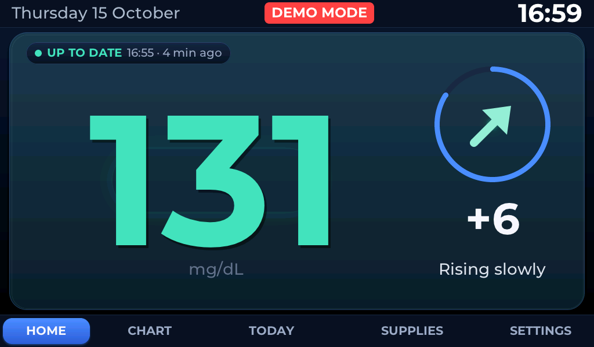
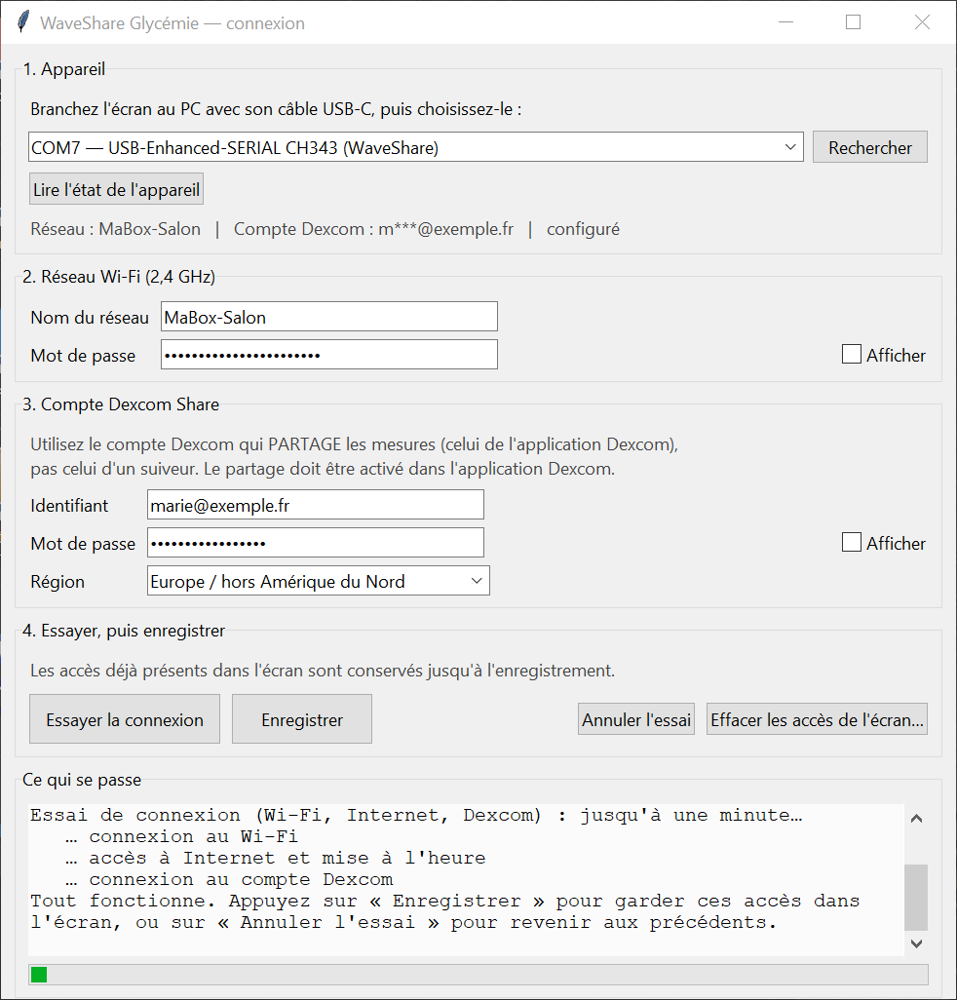
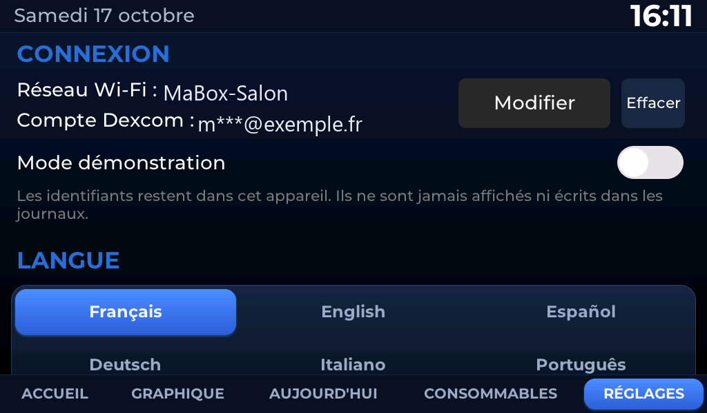

# WaveShare Glycémie — beginner's tutorial

**A 7-inch screen that shows, in large digits, the glucose value shared by a Dexcom G7, with spoken
announcements in six languages.** For the kitchen, a bedroom, a desk.

> ### ⚠️ Read this first
> This device is an **experimental secondary display**, built by a parent — **not a medical
> device**. It can be wrong, show a late value, stop, lose Wi-Fi or stay silent. **It does not
> replace the official Dexcom receiver or app**, and **no treatment decision should be based on what
> it shows**: always check the official app or receiver, and follow your care team's instructions.
> No medical certification or validation is claimed: there is none.

The whole journey: **buy → connect → install → configure → copy the sounds → test → use →
troubleshoot**. Allow one hour the first time. No programming.

---

## 1. Buy the hardware

| What you need | Detail | How it was verified |
|---|---|---|
| The **Waveshare ESP32-P4-WIFI6-Touch-LCD-7B** board | 7″ touch display, 1024 × 600, IPS | [official Waveshare page](https://www.waveshare.com/wiki/ESP32-P4-WIFI6-Touch-LCD-7B); this is the model used for this project |
| A **USB-C data cable** | many cables only carry power: those will not work | tested: the board shows up on the PC as **USB-Enhanced-SERIAL CH343** |
| A **USB-C power supply** | a phone charger, **5 V, 2 A or more** | Waveshare publishes no figure; 2 A comfortably covers the display and audio. A PC USB port may be enough, or may be marginal |
| A **microSD card** | **64 GB SDXC, formatted as FAT32** | that is the card actually used and tested. **exFAT is not recognised** by the firmware |
| A **speaker** (for the announcements) | **PH 2.0** connector on the board, polarity does not matter; Waveshare's own example uses an **8 Ω 2 W** speaker | official Waveshare page |

**Optional:** a stand; a battery (MX1.25 connector on the board).

> **What we do not claim:** no other board reference has been tried. Other 8–64 GB microSD cards in
> FAT32 will very probably work, but only the one in the table was tested. If you use something
> else, say so in an issue: the list will grow.

---

## 2. Connect

The board has **three USB sockets**: two USB-C and one USB-A.

| Socket | What it is for |
|---|---|
| USB-C **"UART"** (CH343 bridge) | **this is the one**: power, firmware installation, configuration from the PC |
| USB-C "USB" (OTG 1.1) | the ESP32-P4's own USB port; **not** used here |
| USB-A | to plug a device *into* the board; not used here |

**How to be sure you have the right one:** plug the cable in, then on the PC open *Device Manager →
Ports (COM & LPT)*. The right socket makes a line appear: **USB-Enhanced-SERIAL CH343 (COMx)**. If
nothing appears: try the other socket, then another cable.

1. With the board powered off, insert the **microSD**, contacts facing down, until it clicks.
2. Plug the **speaker** into the PH 2.0 connector (polarity does not matter).
3. Plug the **USB-C cable** into the UART socket, and the other end into the charger or the PC.

The screen lights up within a few seconds.

> **Photos to be added here** (they are missing, and nothing will be invented): a photo of the back
> of the board showing both USB-C sockets and the BOOT button, a photo of the speaker connector, a
> photo of the microSD in place.

---

## 3. Install the firmware (no compiling)

Download the files from the project's latest *Release*:

- `glycemie_display.bin`, `bootloader.bin`, `partition-table.bin` — the firmware;
- `installer.ps1` — one-command installation;
- `GlycemieConnexion.exe` — the Windows configuration app (step 4, optional);
- `SHA256SUMS.txt` — checksums, to verify your files are intact.

Put them all **in the same folder**. You also need **Python** on the PC
([python.org](https://www.python.org/downloads/), tick "Add python.exe to PATH"), then, once, in
PowerShell:

```powershell
py -3 -m pip install esptool
```

Then right-click **`installer.ps1`** → *Run with PowerShell*. Allow two minutes.

```
Installation sur COM7...
Writing at 0x00010000... (100 %)
C'est installé. L'écran redémarre et affiche l'assistant de configuration.
```

The installation **does not format** the microSD and **does not erase** the memory: it replaces the
firmware, nothing else.

> If several devices are plugged in, the script stops and lists them: run it again with the right
> port, for example `.\installer.ps1 -Port COM7`.

---

## 4. Enter your own credentials

**Nothing to compile, no code to edit.** Two ways, your choice.

### 4a. On the touchscreen (simplest)

On first start, the wizard opens by itself:

1. **Language** — French, English, Spanish, German, Italian, Portuguese.
2. **Wi-Fi network** — the detected networks are listed; tap yours.
   *The network must be **2.4 GHz**: the board cannot see 5 GHz networks.*
3. **Wi-Fi password** — on-screen keyboard, characters hidden, "Show" button if needed.
4. **Dexcom Share account** — your username, your password, and the **region**
   (Europe / North America / Japan).
   *This is the account that **shares** the readings, the one from the Dexcom app — not a follower
   account. Sharing must be switched on in the Dexcom app.*
5. **Check** — the device tries Wi-Fi, then the Internet, then Dexcom, and says in plain words what
   is blocking if anything is.
6. **Save** — and only then are your credentials stored. Until you press it, the previous ones are
   kept.

You can also choose **"Try without an account"**: demo mode shows invented values with a red
**DEMO MODE** banner. Nothing is stored, no account is needed.



### 4b. From the PC, over the USB cable

If typing on the screen is awkward (long password, unresponsive touch), double-click
**`GlycemieConnexion.exe`**. Nothing to install: no Python, no libraries. *(The app's wording is in
French.)*



1. **Rechercher** (Search) → pick the screen in the list (*USB-Enhanced-SERIAL CH343*).
2. **Lire l'état de l'appareil** (Read device state) → shows what is already stored, passwords masked.
3. Fill in the Wi-Fi network, then the Dexcom account and region.
4. **Essayer la connexion** (Try the connection) → the steps scroll in the panel at the bottom.
5. **Enregistrer** (Save) — this button only becomes active **after a successful try**.
6. Unplug for a second, plug back in: the screen connects.

> On first run, Windows may show "Unknown publisher" (SmartScreen): *More info* → *Run anyway*. The
> program is not code-signed — signing is expensive — but its SHA-256 checksum is published: check
> it with `Get-FileHash GlycemieConnexion.exe`.

### Changing or erasing later

**SETTINGS → CONNECTION**, always reachable, even without Wi-Fi and even if the Dexcom account is
refused:

- what is stored (network name, masked account — **never** a password);
- **Modify**: reopens the wizard;
- **Erase**: asks for confirmation, then clears network and account;
- **Demo mode**: switch it on or off whenever you like.




**What the device does with your passwords:** they stay in the device, in a separate area of its
internal memory, scrambled with a key derived from the board's serial number. They are never
displayed, never written to a log, never sent anywhere except to your router and Dexcom's servers.
**This scrambling is not encryption**: someone holding the board who knows what they are doing can
recover them. Hardware flash encryption is deliberately not enabled on this project, because it is
irreversible and would make the device unrecoverable after a mistake.

---

## 5. Copy the sounds onto the microSD

The spoken announcements ("glucose 95, steady", alerts) are pre-recorded audio files, **in six
languages**. Without them the screen works but stays silent (the alert *beeps* always work: those
are generated by the device).

### With a card reader

1. Power the screen off, take the microSD out, put it in the PC.
2. Download the pack for your language, e.g. `glycemie-voix-en-k21.zip` (about 20 MB).
3. Unzip it **at the root of the card**. You should get:
   - in French: the 396 `.wav` files directly in `glycemie\audio\voice\`;
   - in any other language: the 396 files in `glycemie\audio\voice\<language>\`
     (`en`, `es`, `de`, `it` or `pt`).

   > That is exactly how the packs are laid out: nothing to move. French sits at the root because it
   > is the fallback bank when another language is missing.
4. Put the card back in the powered-off screen, switch it on.
5. **SETTINGS → VOICE TEST**: you should hear a sentence.

### Without a card reader — over the USB cable

**The card stays in the screen.** The sounds travel through the cable used for the installation. You
need Python and the sources' `tools/` folder (shipped with this tutorial):

```powershell
py -3 -m pip install pyserial
py -3 tools\voice\sd_voice_upload.py --port COM7 --lang en --log copy_voice_en.log
```

Allow **about 7 minutes per language**. The tool ends with `CONFORME` once the 396 files have been
written and read back. To **check** a card without writing anything to it:

```powershell
py -3 tools\voice\sd_voice_upload.py --port COM7 --lang en --verify-only --log verify_en.log
```

> `--verify-only` sends read commands only: no file written, no folder created.

The same cable also **backs up** what is on the card, again without taking it out:

```powershell
py -3 tools\recuperer_microsd.py --port COM7
```

Several languages can live side by side: `voice\fr\`, `voice\en\`, `voice\es\`… The voice follows
the interface language. Details and file-by-file verification are in
[VOICE_TUTORIAL_EN.md](VOICE_TUTORIAL_EN.md).

> **Do not format the card** if Windows offers to: you would lose the stored history.

---

## 6. Test

| What to check | How | Expected |
|---|---|---|
| It starts | plug it in | the time and the HOME page appear |
| Touch responds | tap the five tabs at the bottom | the page changes each time |
| Wi-Fi is connected | SETTINGS → INFORMATION | *Wi-Fi: connected*, an IP address |
| Dexcom answers | HOME page | a value, and "X min ago" that keeps updating |
| Sound works | SETTINGS → SOUND TEST, then VOICE TEST | a beep, then a spoken sentence |
| Settings persist | change the volume, unplug, plug back in | the volume is kept |

**Never cause a real low blood sugar to test an alert.** Demo mode lets you see and hear the alerts
with no risk at all.

---

## 7. Everyday use

- **HOME**: the value in large digits, the trend arrow, the change since the previous reading, and
  how old it is.
- **CHART**: 3 h, 6 h, 12 h or 24 h; tap the curve to read one measurement.
- **TODAY**: time in range, average, minimum, maximum, high and low episodes.
- **SUPPLIES**: sensor and infusion-set dates, reminders, remaining stock.
- **SETTINGS**: volume, announcements, alerts, night mode, language, connection.

The alert thresholds (55, 80, 300, 350 mg/dL) are the project's own and cannot be changed from the
screen: they match a care team's instructions, not a comfort setting.

---

## 8. Troubleshooting

| Symptom | Most likely cause | What to do |
|---|---|---|
| Nothing lights up | charge-only cable, or wrong socket | change cable; use the **UART** USB-C socket |
| Screen black but sound works | display ribbon cable | power off, check the ribbon |
| "Connection failed" on Wi-Fi | 5 GHz network, or wrong password | enable 2.4 GHz on the router |
| "Dexcom username or password refused" | follower account instead of the sharing account | use the Dexcom app's own account |
| "Account locked" | too many attempts | wait; this is a Dexcom protection |
| No sound | sounds missing from the microSD, or volume at zero | step 5, then SETTINGS → volume |
| The device no longer starts at all | installation interrupted | [RETOUR_ARRIERE_FR.md](RETOUR_ARRIERE_FR.md) (in French), BOOT mode |
| The PC no longer sees the device | another program is holding the port | close serial monitors, replug |

None of this damages the device: everything can be redone.

---

## Going further (technical, optional)

None of this is needed to use the device:

- [INSTALLATION_FR.md](INSTALLATION_FR.md) — install ESP-IDF and **build it yourself** (French).
- [VOICE_TUTORIAL_EN.md](VOICE_TUTORIAL_EN.md) — **generate** the voices with Google Cloud (paid,
  about €2) instead of using the ready-made packs.
- [RETOUR_ARRIERE_FR.md](RETOUR_ARRIERE_FR.md) — back up the device, roll back, recover a screen
  that no longer starts (French).
- [HARDWARE_FR.md](HARDWARE_FR.md) — the board in detail, pinout, partitions (French).
- [LIMITATIONS_FR.md](LIMITATIONS_FR.md) — what the project **does not do**, plainly (French).

---

*Personal project shared for free, without warranty. Dexcom, Waveshare and Google are trademarks of
their respective owners; this project is neither affiliated with nor endorsed by them.*
