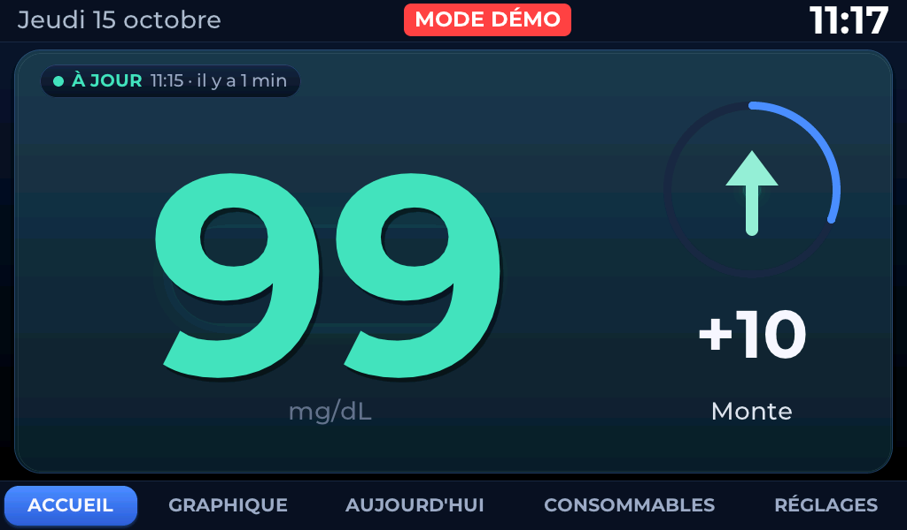
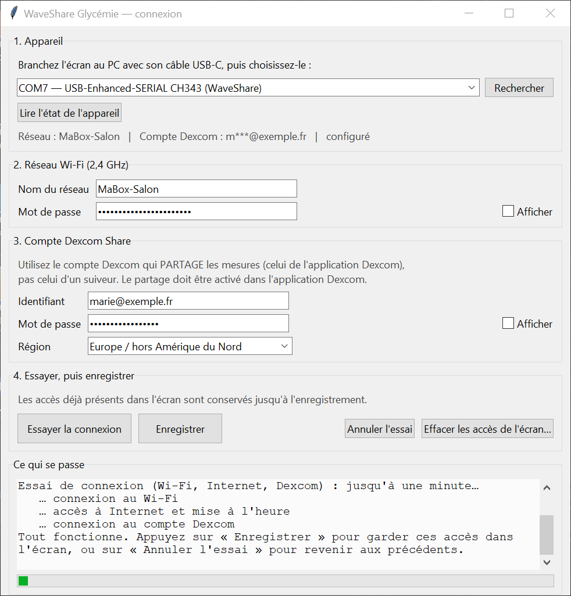
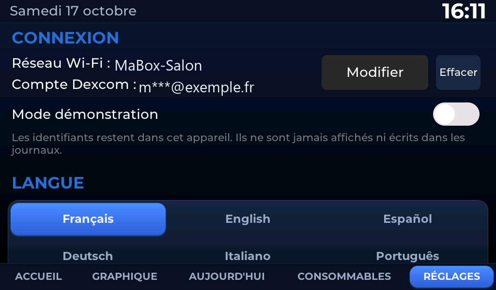

# WaveShare Glycémie — tutoriel pour débuter

**Un écran de 7 pouces qui affiche en grand la glycémie partagée par un Dexcom G7, avec des
annonces parlées en six langues.** Posé dans la cuisine, dans une chambre, au bureau.

> ### ⚠️ À lire avant tout
> Cet appareil est un **affichage complémentaire expérimental**, réalisé par un parent, **pas un
> dispositif médical**. Il peut se tromper, afficher une valeur en retard, s'interrompre, perdre le
> Wi-Fi ou rester muet. **Il ne remplace ni le récepteur ni l'application Dexcom officiels**, et
> **aucune décision de traitement ne doit se fonder sur ce qu'il affiche** : vérifiez toujours sur
> l'application ou le récepteur officiel, et suivez les consignes de votre équipe soignante.
> Aucune certification ni validation médicale n'est revendiquée : il n'y en a aucune.

Le parcours complet : **acheter → brancher → installer → configurer → copier les sons → tester →
utiliser → dépanner**. Comptez une heure la première fois, sans rien programmer.

---

## 1. Acheter le matériel

| Ce qu'il faut | Précision | Vérifié comment |
|---|---|---|
| La carte **Waveshare ESP32-P4-WIFI6-Touch-LCD-7B** | écran tactile 7″, 1024 × 600, IPS | [page officielle Waveshare](https://www.waveshare.com/wiki/ESP32-P4-WIFI6-Touch-LCD-7B) ; c'est le modèle utilisé pour ce projet |
| Un **câble USB-C ↔ USB-A ou USB-C, qui transporte les données** | beaucoup de câbles ne font que charger : ceux-là ne marchent pas | testé : la carte apparaît sur le PC sous le nom **USB-Enhanced-SERIAL CH343** |
| Une **alimentation USB-C** | un chargeur de téléphone **5 V, 2 A ou plus** | Waveshare ne publie pas de valeur ; 2 A couvrent sans peine l'écran et le son. Une prise USB de PC peut suffire, mais peut aussi être juste |
| Une **carte microSD** | **64 Go SDXC, formatée en FAT32** | c'est la carte réellement utilisée et testée. **exFAT n'est pas reconnu** par le programme |
| Un **haut-parleur** (pour les annonces) | connecteur **PH 2.0** sur la carte, polarité indifférente ; l'exemple officiel de Waveshare utilise un **8 Ω 2 W** | page officielle Waveshare |

**Facultatif** : un support ou un pied d'écran ; une batterie (connecteur MX1.25 sur la carte).

> **Ce que nous n'affirmons pas** : aucune autre référence de carte n'a été essayée. D'autres
> microSD de 8 à 64 Go en FAT32 ont toutes les chances de fonctionner, mais seule celle du tableau
> a été testée. Si vous utilisez autre chose, dites-le dans une *issue* : la liste s'enrichira.

---

## 2. Brancher

La carte a **trois prises USB** : deux USB-C et une USB-A.

| Prise | À quoi elle sert |
|---|---|
| USB-C **« UART »** (pont CH343) | **c'est celle-ci** : alimentation, installation du programme, configuration depuis le PC |
| USB-C « USB » (OTG 1.1) | port USB de l'ESP32-P4 lui-même ; **pas** utilisé ici |
| USB-A | pour brancher un périphérique *sur* la carte ; pas utilisé ici |

**Comment être sûr d'avoir la bonne prise :** branchez le câble, puis sur le PC ouvrez
*Gestionnaire de périphériques → Ports (COM et LPT)*. La bonne prise fait apparaître une ligne
**USB-Enhanced-SERIAL CH343 (COMx)**. Si rien n'apparaît : changez de prise, puis de câble.

1. Carte éteinte, insérez la **microSD**, contacts vers le bas, jusqu'au déclic.
2. Branchez le **haut-parleur** sur le connecteur PH 2.0 (la polarité n'a pas d'importance).
3. Branchez le **câble USB-C** sur la prise UART, et l'autre bout sur le chargeur ou le PC.

L'écran s'allume en quelques secondes.

> **Photos à ajouter ici** (elles manquent, et rien ne sera inventé) : une photo de l'arrière de la
> carte montrant les deux prises USB-C et le bouton BOOT, une photo du connecteur du haut-parleur,
> une photo de la microSD en place. Envoyez-les : elles seront insérées à cet endroit.

---

## 3. Installer le programme (sans rien compiler)

Téléchargez les fichiers de la dernière *Release* du projet :

- `glycemie_display.bin`, `bootloader.bin`, `partition-table.bin` — le programme ;
- `installer.ps1` — l'installation en une commande ;
- `GlycemieConnexion.exe` — l'application de configuration pour Windows (étape 4, facultative) ;
- `SHA256SUMS.txt` — les empreintes, pour vérifier que vos fichiers sont intacts.

Mettez-les tous **dans le même dossier**. Il faut aussi **Python** sur le PC ([python.org](https://www.python.org/downloads/),
cochez « Add python.exe to PATH »), puis, une seule fois, dans PowerShell :

```powershell
py -3 -m pip install esptool
```

Ensuite, clic droit sur **`installer.ps1`** → *Exécuter avec PowerShell*. Comptez deux minutes.

```
Installation sur COM7...
Writing at 0x00010000... (100 %)
C'est installé. L'écran redémarre et affiche l'assistant de configuration.
```

L'installation **ne formate pas** la microSD et **n'efface pas** la mémoire : elle remplace le
programme, rien d'autre.

> Si plusieurs appareils sont branchés, le script s'arrête et vous montre la liste : relancez-le
> avec la bonne prise, par exemple `.\installer.ps1 -Port COM7`.

---

## 4. Configurer vos accès

**Rien à compiler, rien à modifier dans le code.** Deux chemins, au choix.

### 4a. Sur l'écran tactile (le plus simple)

Au premier démarrage, l'assistant s'ouvre tout seul :

1. **Langue** — français, anglais, espagnol, allemand, italien, portugais.
2. **Réseau Wi-Fi** — la liste des réseaux détectés s'affiche ; touchez le vôtre.
   *Le Wi-Fi doit être en **2,4 GHz** : la carte ne voit pas les réseaux 5 GHz.*
3. **Mot de passe du Wi-Fi** — clavier à l'écran, caractères masqués, bouton « Afficher » si besoin.
4. **Compte Dexcom Share** — votre identifiant, votre mot de passe, et la **région**
   (Europe / Amérique du Nord / Japon).
   *C'est le compte qui **partage** les mesures, celui de l'application Dexcom — pas un compte de
   suiveur. Le partage doit être activé dans l'application Dexcom.*
5. **Vérification** — l'appareil essaie le Wi-Fi, puis Internet, puis Dexcom, et écrit en clair ce
   qui bloque le cas échéant.
6. **Enregistrer** — et seulement là, vos accès sont enregistrés. Tant que vous n'avez pas appuyé,
   les accès précédents sont conservés.

Vous pouvez aussi choisir **« Essayer sans compte »** : le mode démonstration affiche des valeurs
inventées, avec un bandeau rouge **MODE DÉMO**. Rien n'est enregistré, aucun compte n'est nécessaire.



### 4b. Depuis le PC, par le câble USB

Si taper au doigt est pénible (mot de passe long, écran qui répond mal), double-cliquez sur
**`GlycemieConnexion.exe`**. Rien à installer : ni Python, ni bibliothèque.



1. **Rechercher** → choisissez l'écran dans la liste (il s'appelle *USB-Enhanced-SERIAL CH343*).
2. **Lire l'état de l'appareil** → il affiche ce qui est déjà enregistré, mots de passe masqués.
3. Remplissez le réseau Wi-Fi, puis le compte Dexcom et la région.
4. **Essayer la connexion** → les étapes défilent dans la fenêtre du bas.
5. **Enregistrer** — ce bouton ne s'active **qu'après un essai réussi**.
6. Débranchez une seconde, rebranchez : l'écran se connecte.

> Au premier lancement, Windows peut afficher « Éditeur inconnu » (SmartScreen) : *Informations
> complémentaires* → *Exécuter quand même*. Le programme n'est pas signé numériquement — signer
> coûte cher — mais son empreinte SHA-256 est publiée : vous pouvez la vérifier avec
> `Get-FileHash GlycemieConnexion.exe`.

### Changer ou effacer plus tard

**RÉGLAGES → CONNEXION**, toujours accessible, même sans Wi-Fi et même si le compte Dexcom est
refusé :

- ce qui est enregistré (nom du réseau, compte masqué — **jamais** un mot de passe) ;
- **Modifier** : rouvre l'assistant ;
- **Effacer** : demande confirmation, puis efface réseau et compte ;
- **Mode démonstration** : à activer ou couper quand vous voulez.




**Ce que l'appareil fait de vos mots de passe :** ils restent dans l'appareil, dans un espace séparé
de la mémoire interne, mélangés avec une clé dérivée du numéro de série de la carte. Ils ne sont
jamais affichés, jamais écrits dans un journal, jamais envoyés ailleurs qu'à votre box et aux
serveurs Dexcom. **Ce brouillage n'est pas un chiffrement** : quelqu'un qui a la carte en main et
qui sait faire peut les retrouver. Le chiffrement matériel de la mémoire n'est pas activé sur ce
projet, parce qu'il est irréversible et rendrait l'appareil non récupérable en cas d'erreur.

---

## 5. Copier les sons sur la microSD

Les annonces parlées (« glycémie 95, stable », alertes) sont des fichiers audio préparés à l'avance,
**en six langues**. Sans eux, l'écran fonctionne mais reste muet (les alertes sonores, elles,
marchent toujours : ce sont des bips produits par l'appareil).

### Avec un lecteur de carte

1. Éteignez l'écran, sortez la microSD, mettez-la dans le PC.
2. Téléchargez le paquet de votre langue, par exemple `glycemie-voix-fr-k21.zip` (environ 20 Mo).
3. Décompressez-le **à la racine de la carte**. Vous devez obtenir :
   - en français : les 396 fichiers `.wav` directement dans `glycemie\audio\voice\` ;
   - dans une autre langue : les 396 fichiers dans `glycemie\audio\voice\<langue>\`
     (`en`, `es`, `de`, `it` ou `pt`).

   > C'est exactement ce que contiennent les paquets : il n'y a rien à déplacer. Le français est à la
   > racine parce que c'est la banque de secours quand une autre langue manque.
4. Remettez la carte dans l'écran éteint, rallumez.
5. **RÉGLAGES → TEST VOIX** : vous devez entendre une phrase.

### Sans lecteur de carte — par le câble USB

**La carte reste dans l'écran.** Les sons passent par le câble qui a servi à l'installation. Il faut
Python et le dossier `tools/` des sources (il est fourni avec ce tutoriel) :

```powershell
py -3 -m pip install pyserial
py -3 tools\voice\sd_voice_upload.py --port COM7 --lang fr --log copie_voix_fr.log
```

Comptez **environ 7 minutes par langue**. L'outil se termine par `CONFORME` quand les 396 fichiers
ont été écrits puis relus. Pour **vérifier** une carte sans rien y écrire :

```powershell
py -3 tools\voice\sd_voice_upload.py --port COM7 --lang fr --verify-only --log verif_fr.log
```

> `--verify-only` n'envoie que des commandes de lecture : aucun fichier écrit, aucun dossier créé.

Le même câble sert aussi à **sauvegarder** le contenu de la carte, toujours sans la sortir :

```powershell
py -3 tools\recuperer_microsd.py --port COM7
```

Plusieurs langues peuvent cohabiter : `voice\fr\`, `voice\en\`, `voice\es\`… La voix suit la langue
de l'interface. Les détails et la vérification fichier par fichier sont dans
[TUTORIEL_VOIX_FR.md](TUTORIEL_VOIX_FR.md).

> **Ne formatez pas la carte** si Windows vous le propose : vous perdriez l'historique des mesures.

---

## 6. Tester

| À vérifier | Comment | Résultat attendu |
|---|---|---|
| L'écran démarre | branchez | l'heure et la page ACCUEIL apparaissent |
| Le tactile répond | touchez les cinq onglets du bas | la page change à chaque fois |
| Le Wi-Fi est connecté | RÉGLAGES → INFORMATION | *Wi-Fi : connecté*, une adresse IP |
| Dexcom répond | page ACCUEIL | une valeur, et « il y a X min » qui se met à jour |
| Le son marche | RÉGLAGES → TEST SON puis TEST VOIX | un bip, puis une phrase parlée |
| Les réglages tiennent | changez le volume, débranchez, rebranchez | le volume est conservé |

**Ne provoquez jamais une vraie hypoglycémie pour tester une alerte.** Le mode démonstration permet
de voir et d'entendre les alertes sans aucun risque.

---

## 7. Utiliser au quotidien

- **ACCUEIL** : la valeur en grand, la flèche de tendance, l'écart avec la mesure précédente, et
  depuis combien de temps elle date.
- **GRAPHIQUE** : 3 h, 6 h, 12 h ou 24 h ; appuyez sur la courbe pour lire une mesure précise.
- **AUJOURD'HUI** : temps dans la cible, moyenne, minimum, maximum, épisodes hauts et bas.
- **CONSOMMABLES** : date de pose du capteur et du cathéter, rappels, stock restant.
- **RÉGLAGES** : volume, annonces, alertes, mode nuit, langue, connexion.

Les seuils d'alerte (55, 80, 300, 350 mg/dL) sont ceux du projet et ne se modifient pas depuis
l'écran : ils correspondent aux consignes d'une équipe soignante, pas à un réglage de confort.

---

## 8. Dépanner

| Symptôme | Cause la plus fréquente | Quoi faire |
|---|---|---|
| Rien ne s'allume | câble de charge sans données, ou mauvaise prise | changez de câble, prenez la prise USB-C **UART** |
| L'écran reste noir mais le son marche | nappe d'écran | éteignez, vérifiez la nappe |
| « Connexion impossible » au Wi-Fi | réseau en 5 GHz, ou mot de passe | activez le 2,4 GHz sur la box |
| « Identifiant ou mot de passe Dexcom refusé » | compte suiveur au lieu du compte partageur | utilisez le compte de l'application Dexcom |
| « Compte bloqué » | trop d'essais | attendez ; c'est une protection de Dexcom |
| Pas de son | sons absents de la microSD, ou volume à zéro | étape 5, puis RÉGLAGES → volume |
| L'appareil ne démarre plus du tout | programme interrompu pendant l'installation | [RETOUR_ARRIERE_FR.md](RETOUR_ARRIERE_FR.md), mode BOOT |
| Le PC ne voit plus l'appareil | un autre logiciel occupe le port | fermez les moniteurs série, rebranchez |

Rien de tout cela n'abîme l'appareil : tout se refait.

---

## Pour aller plus loin (partie technique, facultative)

Rien de ceci n'est nécessaire pour utiliser l'appareil :

- [INSTALLATION_FR.md](INSTALLATION_FR.md) — installer ESP-IDF et **compiler soi-même**.
- [TUTORIEL_VOIX_FR.md](TUTORIEL_VOIX_FR.md) — **générer** les voix avec Google Cloud (payant,
  environ 2 €) au lieu d'utiliser les paquets prêts à copier.
- [RETOUR_ARRIERE_FR.md](RETOUR_ARRIERE_FR.md) — sauvegarder l'appareil, revenir en arrière,
  récupérer un écran qui ne démarre plus.
- [HARDWARE_FR.md](HARDWARE_FR.md) — la carte en détail, brochage, partitions.
- [LIMITATIONS_FR.md](LIMITATIONS_FR.md) — ce que le projet **ne fait pas**, dit franchement.
- [ARCHITECTURE_FR.md](ARCHITECTURE_FR.md) — comment le programme est construit.

---

*Projet personnel partagé gratuitement, sans garantie. Les marques Dexcom, Waveshare et Google
appartiennent à leurs propriétaires ; ce projet n'est ni affilié ni approuvé par elles.*
