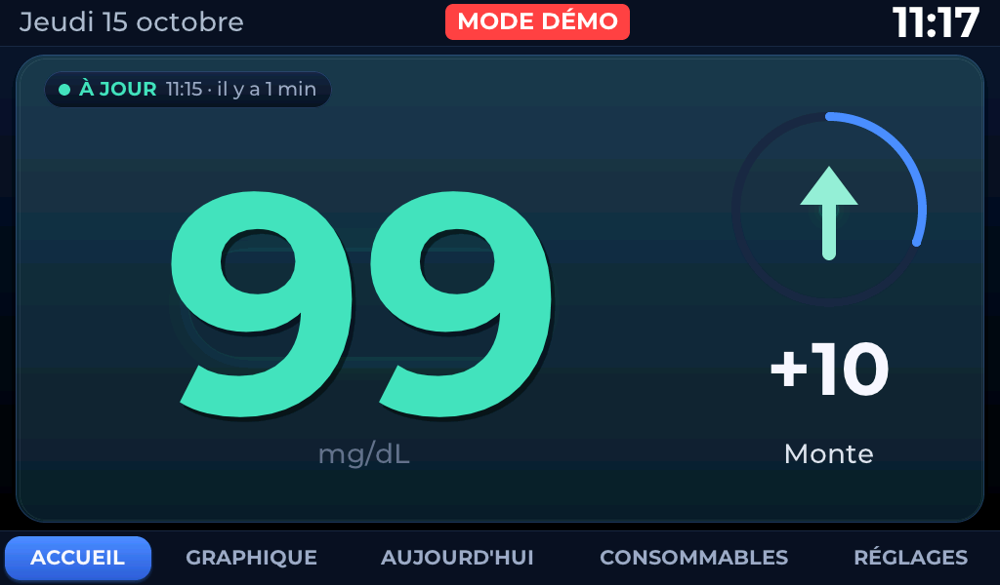
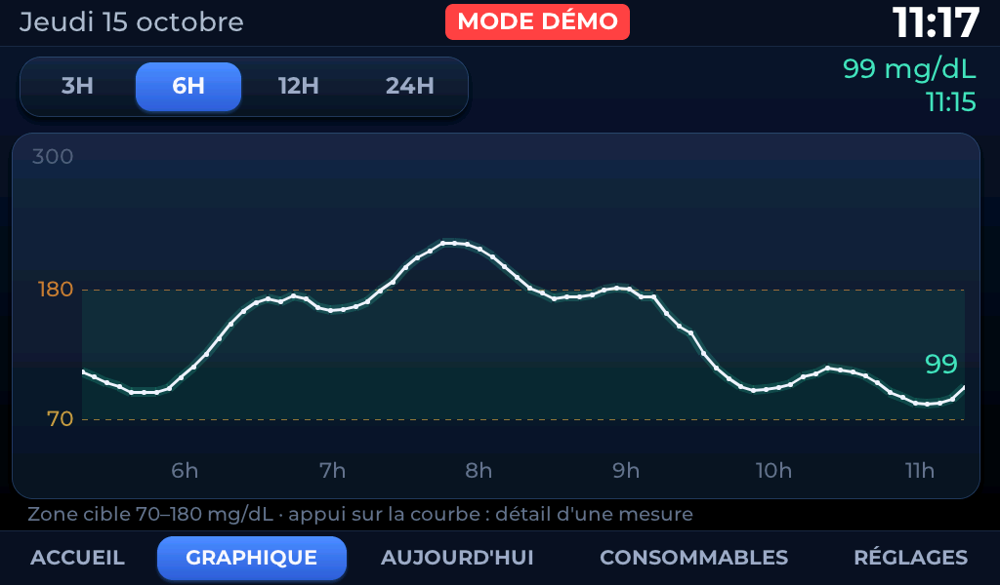
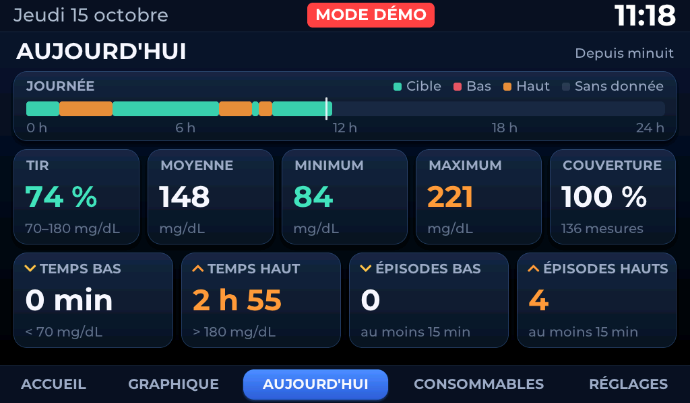
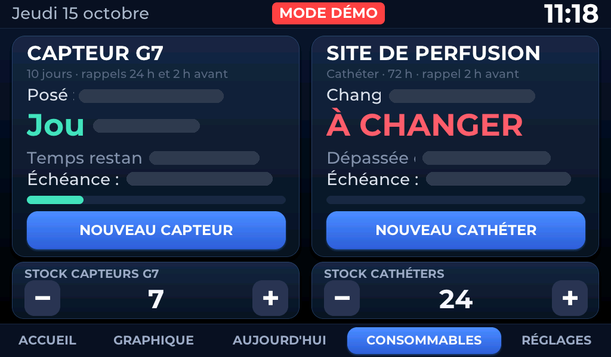
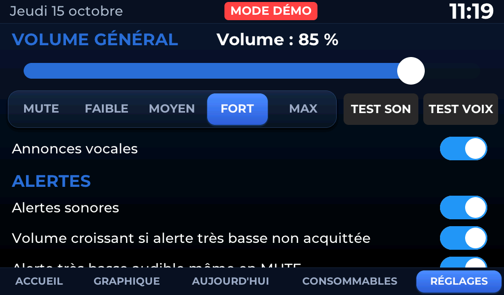

# Daily use

The device works alone: connected, it displays blood glucose and reconnects on its own.
This document describes what we see, what we hear, and the only useful actions.

---

## The top banner (same on the 5 pages)

| Area | Content |
|---|---|
| Left | long-standing ("Thursday 15 October") |
| Centre | `MODE DÉMO` if active and alert status. Voice recognition is not active in the public program. |
| Right | hour, in 44 px (readable from afar) |

There are **no** Wi-Fi / Internet / Dexcom / SD lights: they have been removed
Will. The detailed status of the links is on the page **REGULATIONS**, and the cause of a
old data is displayed directly on the welcome.

The bottom bar gives the five pages; The active page is a blue pill.

---

## ACCUEIL

One big card, nothing else: it's meant.

- **Chicken of freshness** at the top left: `● À JOUR` (green, < 6 min),
  `● RETARD` (orange, 6–10 min), `● DONNÉES ANCIENNES` (red, ≥ 10 min), followed by
  the actual time of the last measurement and its age ("11:15 · 1 min ago").
- **Value 320 px** in the left center, with its light and a thin shadow.
- **Column of trend** on the right: ring of freshness (200 px), arrow drawn
  (128 px, slow respiration glow), variation from previous measurement (`+10`),
  trend wording ("Monte").
- Press anywhere on the map opens the page GRAPHIQUE.

The display adapts without adding any information:

| Situation | Effect |
|---|---|
| Rapid trend | brighter light and sharper arrow, colorful variation and trend |
| RETARD | 80 % opacity value, more readable tablet and age |
| DATA ANCIENNES | 60% retained but grey value, arrow and change in `--`, **cause displayed** under the pastille (Wi-Fi coupe, Dexcom unavailable...) |

Value Colors (show only, independent of alert thresholds):
< 54 soft red · 54–69 amber · 70–180 blue green · 181–250 orange · > 250 soft red.

---

## GRAPHIQUE

- Pills **3H / 6H / 12H / 24H**: instants, read in cache, no network request.
- Target area 70–180 mg/dL shaded, marked 70 and 180 dotted.
- **Tactile exploration**: a support or slip selects the **Actual measurement**
  nearer horizontally — never an interpolated value — and displays a vertical line,
  the point and bubble (hour, blood glucose, trend and variation if history
  contains). The bubble passes to the other side near one edge. The cursor disappears 4 s after
  release.
- A hole in the data remains visible: the curve is not blocked.

---

## AUJOURD'HUI

Only page of statistics, calculated **since midnight** (local time) on history in
memory — no network request.

- **Daybreak**: 96 15 min slots (target, low, high, without data) and 1
  current time marker.
- **TIR** (time in target 70–180), **average**, **minimum**, **maximum**,
  **coverage** (measures received/anticipated, with number of measures).
- ** Low time** (< 70) and **high time** (> 180), counted 5 min per measurement.
- **Episodes low/high**: at least 3 consecutive measurements (15 min); a difference of more than
  10 min cuts the episode.

Under **70 % coverage**, a heading "Inadequate coverage:
reliable" is displayed and the numbers are grayed.

---

## CONSOMMABLES

*(On this capture, the actual dates of pose are hidden: personal data.) *

### G7 sensor

- **Deadline = pose + 10 days exactly.** The 12 hours of Dexcom grace do not prolong the
  meter, neither the deadline, nor the reminders.
- View: pose date, "Day N / 10", remaining time, progress bar, deadline.
  Due date: **To CHANGER**, without ringing.
- **Two reminders only**, once each per sensor:
  **24 hours before** ("Recall. The sensor needs to be changed tomorrow. ) and
  **2 hours before** ("Recall. The sensor must be changed in two hours.").

### Infusion site (catheter)

- Default interval **72 h**, **48 h** possible (REGISTRATIONS > CONSOMMABLES).
- **One reminder, 2 hours before the deadline**, then **To CHANGER** on due date, without ringing.
- It is a reminder chosen by the user, **not** a therapeutic recommendation.

### Save Change

Press **NOUVEAU CAPTEUR** or **NOUVEAU CATHETER** → one confirmation
"New sensor now? » → **OUI, MAINTENANT** Now is the time to
Start. There is **no date or time entry**. Without synchronized time (SNTP), nothing
is registered.

### Stock

Under each section, a map `[ − ] quantité [ + ]`. A pressure on the quantity opens a
direct input (−10 / -1 / +1 / +10). As long as nothing is seized, the quantity is
**NON INCREASE**: no decrementation turns it into 0. The stock is never
negative, and it is decremented **only once by actually recorded change** —
a restart, double confirmation or replay never consume two units.
Discreet mention **STOCK FAIBLE** at the threshold (2 sensors, ≤ 3 catheters by default).

> **Filing dates, recalls and inventories are recorded in NVS.
> A restart, a reflection of the application or a recompilation does not erase them. **

---

## REGISTERS

Defilable page on finger:

- **VOLUME GENERAL**: cursor 0–100%, shortcuts MUTE / FAIBLE (35 %) / MOYEN (60 %) /
  FORT (85 %) / MAX (100%), buttons **TEST SON** and **TEST VOIX**.
  85% is the recommended clean level (beyond, the analog stage sature).
- **Voice statements**: activates or cuts voice (beeps remain).
- **ALERTES**: sound alerts, increasing volume if a critical alert is not
  acquitted, "Very low alert audible even in MUTE ».
- **Thresholds** (no 5 mg/dL) : very low, low, high, very high.
  Default values: **55 / 70 / 250 / 300**.
- ** SCREEN** : brightness day.
- **MODE NUIT** : activation, beginning (22:00), end (07:00), brightness night, **TEST MODE NUIT**.
- **CONSOMMABLES**: catheter interval 48 H / 72 H.
- **CONNEXION**: Wi-Fi and Dexcom status, access modification and demo mode. The recognition of voice commands is absent from the public program.
- **INFORMATIONS**: Detailed status of links, number of voice files present, versions.

---

## Alerts

| Alert | Condition (given less than 10 min) | Repetition while not acquitted | If condition persists after OK |
|---|---|---|---|
| **TRESS BASSE** | < 55 mg/dL | every 20 seconds, without limit, increasing volume (+10%/sound) | new alarm after 15 min |
| **BASSE** | < 70 | every 60 seconds, 10 times | 30 minutes |
| **AUCUNE REPORT** | ≥ 15 min without measurement | every 2 minutes, 3 times | 60 min |
| **Elevated** | > 300 | every 2 minutes, 5 times | 60 min |
| ** HIGH** | > 250 | every 5 minutes, twice | 120 min |
| **CAPTEUR** | reminder 24 hours and 2 hours before due date | once | — |
| **CATHETER** | reminder 2 h before due date | once | — |

- Only one alert displayed at a time (priority: very low, low, no data, very
  high, high, sensor, catheter), with output hysteresis.
- **Full screen panel** touch: **OK** (charge) or **RAPPEL DANS 30 MIN** (delayed).
  It closes automatically at the end of **30 s** with return to reception; the alert remains
  activates and continues to ring according to its repetitions, without blocking the screen.
- **Indicator in banner**: tablet **full** until alert is paid
  (a support reopens the panel), **contour alone** as long as the condition persists after OK.

Sound sequence: alert beep → 150 ms → alert phrase → 300 ms → value. By
example "Warning, low blood sugar. Glycemia seventy-eight. »

There are **no announcements for each new measure**: the voice is reserved for alerts,
reminders, to TEST VOIX and responses to voice commands.

---

## Night mode

During the time range (22:00–07:00 by default), the screen switches to a display
minimalist on black background, at night brightness: hour in 96 px, blood glucose in 260 px,
arrow, status, "Last measure: HH:MM (there is X min)". No graphics, no statistics.

- Everything normally continues in the background (Dexcom, Wi-Fi, microSD, alerts, sound).
- **A touch** returns the normal interface for 30 seconds, then the night screen returns.
- **An alert** is given priority and is displayed at daylight brightness; Back to the night screen
  45 seconds after the sign disappears. « Very low alert audible even in MUTE remains active.
- **TEST MODE NUIT** gives an immediate overview without changing schedules (maximum 60 s).

---

## Screen language

REGISTERS > **LANGUE**: six languages of choice, each written in its own language.

| | | |
|---|---|---|
| French | English | Español |
| Deutsch | Italiano | Português |

The change is **immediate**: the five pages, the banner, the alert panel and the night screen
are rewritten in the second. The choice is recorded in NVS and survives a restart as in
a recompilation.

All text on the screen, day and month names, date and date formats are translated.
duration, **and voice announcements**.

### The voice follows the language

Each language has its own bank of 396 files WAV on the microSD, recorded with ** the same
stamp** (voice Google Chirp 3 HD "Aoede") :

| MicroSD folder | Language | Votes |
|---|---|---|
| `/glycemie/audio/voice/` | French | `fr-FR-Chirp3-HD-Aoede` |
| `/glycemie/audio/voice/en/` | English | `en-US-Chirp3-HD-Aoede` |
| `/glycemie/audio/voice/es/` | Spanish | `es-ES-Chirp3-HD-Aoede` |
| `/glycemie/audio/voice/de/` | German | `de-DE-Chirp3-HD-Aoede` |
| `/glycemie/audio/voice/it/` | Italian | `it-IT-Chirp3-HD-Aoede` |
| `/glycemie/audio/voice/pt/` | Portuguese | `pt-BR-Chirp3-HD-Aoede` |

In English, a bass alert says "Warning, low glucose. Glucose seventy-eight. »

**If the bank of a language is not installed on the map, the French voice takes over**
rather than being silent; If French is missing, the warning beep is used as a help. The
Portuguese is recorded with a Brazilian voice: Google does not offer a Chirp 3 HD voice in
European Portuguese.

**Not translated, voluntarily:**

- **Voice controls**—recognised sentences remain "Glycemia", "Glucose",
  "Save new sensor", "Confirm sensor", "New catheter"; the engine ESP-SR
  exists only with an English model and these sentences have been finely settled in French;
- ** microSD log and files CSV** — for old and
  new products remain comparable;
- **Series console**, which is a development tool.

From the console: `lang` displays the current language, `lang en` (or `fr`, `es`, `de`, `it`, `pt`)
changes it as would a support on the screen.

---

## Voice commands (optional, offline)

Default disabled. To be activated in FRANÇAIS > COMMANDES VOCALES. Recognition
**fully local** by the map microphones: no cloud, no connection.

| Phrase | Effect |
|---|---|
| "Glycemia" / "Glucose" | announces the value and trend: "Glycemia one hundred and fifteen. Stable. » |
| "Save New Sensor" | **records nothing**: replies "New sensor. Say confirm sensor. » |
| « Confirm sensor » | **within 10 s** after the announcement: records the installation |
| "New catheter" | a first time: "Repetit to confirm"; a second time within 10 seconds: records |

Two **different sentences** are required for the sensor: repeat the first one not valid
Never. If nothing is confirmed, "Order cancelled. Then **anti-repetition**:
"Save New Sensor" is ignored without an announcement for 5 minutes.

Touch buttons do not depend on voice or anti-repetition.

**Honest limitations**: the recognition engine is a **English** model (Espressive only)
provides no free French model), the French sentences are written phonetically.
The recognition is reliable about 1 m in French, better remotely in English, and
sensitive to ambient noise. The scores are low (0.14 to 0.36): thresholds per order
have been set to eliminate spontaneous triggers, at a cost of a bit of scope.

---

## Demonstration mode

From the serial console, `demo normal` (or `low`, `verylow`, `high`, `veryhigh`, `gap`,
`stale`, `sparse`) fills the history with 24 hours of data **fictives**. A red bandeau
`MODE DÉMO` appears, and **nothing is written on the microSD**. `demo off` data
actual and erase simulated data.

This is the right way to show the camera, make screenshots or try it.
without Dexcom account.

---

## Important reminder

This device is a ** complementary family display**. Security alarms remain
the sensors and the phones. No therapeutic decision should be based on this
he's showing.
