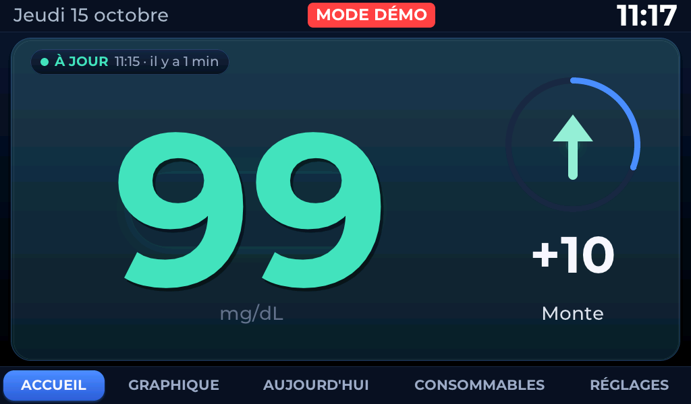
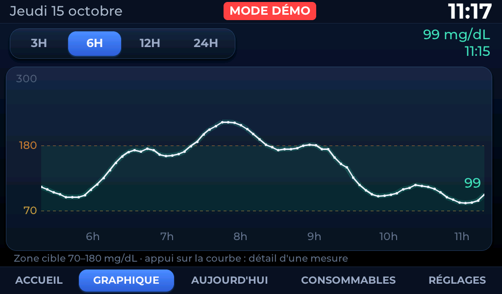
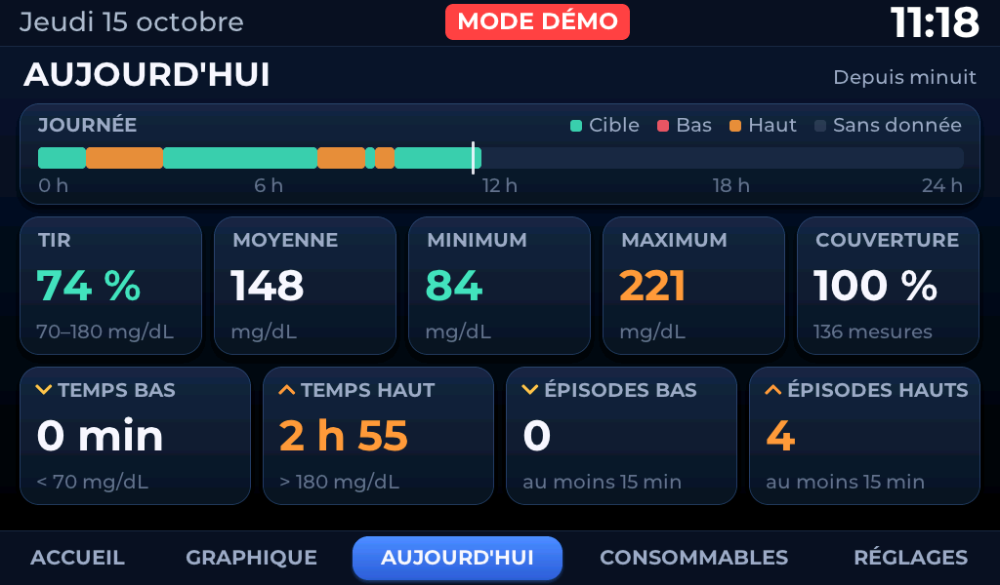
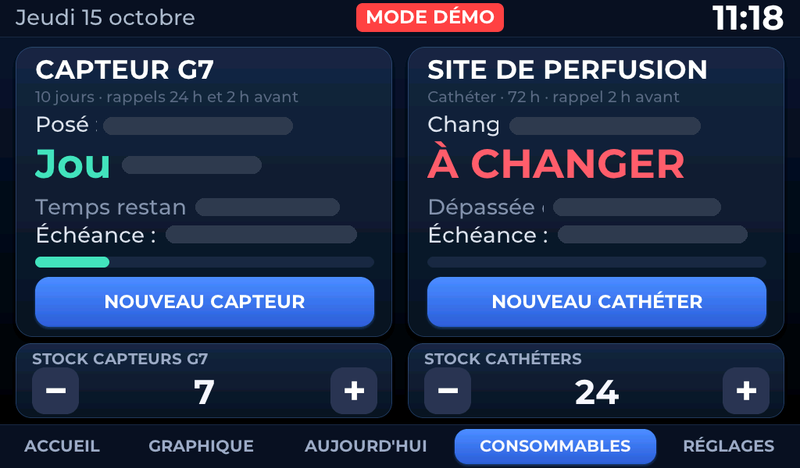
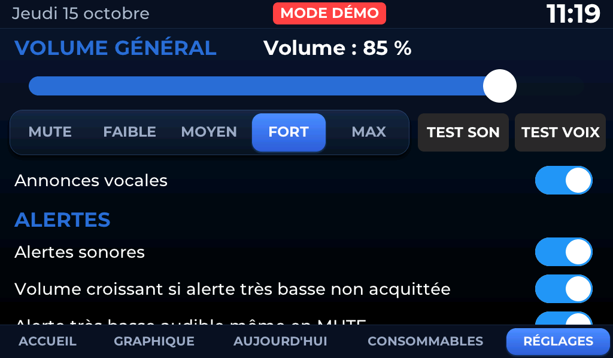

# Utilisation au quotidien

L'appareil fonctionne seul : branché, il affiche la glycémie et se reconnecte tout seul.
Ce document décrit ce qu'on voit, ce qu'on entend, et les seules actions utiles.

---

## Le bandeau du haut (identique sur les 5 pages)

| Zone | Contenu |
|---|---|
| Gauche | date longue (« Jeudi 15 octobre ») |
| Centre | `MODE DÉMO` si actif, indicateur d'alerte, pastille des commandes vocales |
| Droite | heure, en 44 px (lisible de loin) |

Il n'y a **pas** de voyants Wi-Fi / Internet / Dexcom / SD : ils ont été retirés
volontairement. L'état détaillé des liaisons est sur la page **RÉGLAGES**, et la cause d'une
donnée ancienne s'affiche directement sur l'accueil.

La barre du bas donne les cinq pages ; la page active est une pilule bleue.

---

## ACCUEIL

Une seule grande carte, rien d'autre : c'est voulu.

- **Pastille de fraîcheur** en haut à gauche : `● À JOUR` (vert, < 6 min),
  `● RETARD` (orange, 6–10 min), `● DONNÉES ANCIENNES` (rouge, ≥ 10 min), suivie de
  l'heure réelle de la dernière mesure et de son âge (« 11:15 · il y a 1 min »).
- **Valeur 320 px** au centre gauche, avec sa lueur et une fine ombre portée.
- **Colonne de tendance** à droite : anneau de fraîcheur (200 px), flèche dessinée
  (128 px, lueur à respiration lente), variation depuis la mesure précédente (`+10`),
  libellé de tendance (« Monte »).
- Un appui n'importe où sur la carte ouvre la page GRAPHIQUE.

L'affichage s'adapte sans ajouter d'information :

| Situation | Effet |
|---|---|
| Tendance rapide | lueur et flèche plus marquées, variation et tendance colorées |
| RETARD | valeur à 80 % d'opacité, pastille et âge plus lisibles |
| DONNÉES ANCIENNES | valeur conservée mais grise à 60 %, flèche et variation en `--`, **cause affichée** sous la pastille (Wi-Fi coupé, Dexcom indisponible…) |

Couleurs de la valeur (affichage uniquement, indépendantes des seuils d'alerte) :
< 54 rouge doux · 54–69 ambre · 70–180 vert-bleu · 181–250 orange · > 250 rouge doux.

---

## GRAPHIQUE

- Pilules **3H / 6H / 12H / 24H** : instantanées, lues dans le cache, aucune requête réseau.
- Zone cible 70–180 mg/dL ombrée, repères 70 et 180 en pointillés.
- **Exploration tactile** : un appui ou un glissement sélectionne la **mesure réelle** la
  plus proche horizontalement — jamais une valeur interpolée — et affiche un trait vertical,
  le point et une bulle (heure, glycémie, tendance et variation si l'historique les
  contient). La bulle passe de l'autre côté près d'un bord. Le curseur disparaît 4 s après
  le relâchement.
- Un trou dans les données reste visible : la courbe n'est pas « bouchée ».

---

## AUJOURD'HUI

Seule page de statistiques, calculée **depuis minuit** (heure locale) sur l'historique en
mémoire — aucune requête réseau.

- **Frise de la journée** : 96 créneaux de 15 min (cible, bas, haut, sans donnée) et un
  repère de l'heure courante.
- **TIR** (temps dans la cible 70–180), **moyenne**, **minimum**, **maximum**,
  **couverture** (mesures reçues / attendues, avec le nombre de mesures).
- **Temps bas** (< 70) et **temps haut** (> 180), comptés 5 min par mesure.
- **Épisodes bas / hauts** : au moins 3 mesures consécutives (15 min) ; un écart de plus de
  10 min coupe l'épisode.

Sous **70 % de couverture**, un bandeau « Couverture insuffisante : statistiques non
fiables » s'affiche et les chiffres sont grisés.

---

## CONSOMMABLES

*(Sur cette capture, les dates réelles de pose sont masquées : données personnelles.)*

### Capteur G7

- **Échéance = pose + 10 jours exactement.** Les 12 h de grâce Dexcom ne prolongent ni le
  compteur, ni l'échéance, ni les rappels.
- Affichage : date de pose, « Jour N / 10 », temps restant, barre de progression, échéance.
  À l'échéance : **À CHANGER**, sans sonnerie.
- **Deux rappels seulement**, une fois chacun par capteur :
  **24 h avant** (« Rappel. Le capteur doit être changé demain. ») et
  **2 h avant** (« Rappel. Le capteur doit être changé dans deux heures. »).

### Site de perfusion (cathéter)

- Intervalle **72 h** par défaut, **48 h** possible (RÉGLAGES > CONSOMMABLES).
- **Un seul rappel, 2 h avant l'échéance**, puis **À CHANGER** à l'échéance, sans sonnerie.
- C'est un rappel choisi par l'utilisateur, **pas** une recommandation thérapeutique.

### Enregistrer un changement

Appuyer sur **NOUVEAU CAPTEUR** ou **NOUVEAU CATHÉTER** → une seule confirmation
« Nouveau capteur maintenant ? » → **OUI, MAINTENANT**. L'heure actuelle devient l'heure de
départ. Il n'y a **aucune saisie de date ni d'heure**. Sans heure synchronisée (SNTP), rien
n'est enregistré.

### Stock

Sous chaque section, une carte `[ − ] quantité [ + ]`. Un appui sur la quantité ouvre une
saisie directe (−10 / −1 / +1 / +10). Tant que rien n'est saisi, la quantité est
**NON RENSEIGNÉE** : aucune décrémentation ne la transforme en 0. Le stock n'est jamais
négatif, et il est décrémenté **une seule fois par changement réellement enregistré** —
un redémarrage, une double confirmation ou un rejeu ne consomment jamais deux unités.
Mention discrète **STOCK FAIBLE** au seuil (≤ 2 capteurs, ≤ 3 cathéters par défaut).

> **Les dates de pose, les rappels déjà sonnés et les stocks sont enregistrés en NVS.
> Un redémarrage, un reflash de l'application ou une recompilation ne les efface pas.**

---

## RÉGLAGES

Page défilable au doigt :

- **VOLUME GÉNÉRAL** : curseur 0–100 %, raccourcis MUTE / FAIBLE (35 %) / MOYEN (60 %) /
  FORT (85 %) / MAX (100 %), boutons **TEST SON** et **TEST VOIX**.
  85 % est le niveau propre recommandé (au-delà, l'étage analogique sature).
- **Annonces vocales** : active ou coupe la voix (les bips restent).
- **ALERTES** : alertes sonores, volume croissant si une alerte critique n'est pas
  acquittée, « Alerte très basse audible même en MUTE ».
- **Seuils** (pas de 5 mg/dL) : très basse, basse, haute, très haute.
  Valeurs par défaut : **55 / 70 / 250 / 300**.
- **ÉCRAN** : luminosité jour.
- **MODE NUIT** : activation, début (22:00), fin (07:00), luminosité nuit, **TEST MODE NUIT**.
- **CONSOMMABLES** : intervalle du cathéter 48 H / 72 H.
- **COMMANDES VOCALES** : activation, mot d'éveil « Bonjour ESP », état.
- **INFORMATIONS** : état détaillé des liaisons, nombre de fichiers vocaux présents, versions.

---

## Alertes

| Alerte | Condition (donnée de moins de 10 min) | Répétition tant que non acquittée | Si la condition persiste après OK |
|---|---|---|---|
| **TRÈS BASSE** | < 55 mg/dL | toutes les 20 s, sans limite, volume croissant (+10 %/sonnerie) | nouvelle alerte après 15 min |
| **BASSE** | < 70 | toutes les 60 s, 10 fois | 30 min |
| **AUCUNE DONNÉE** | ≥ 15 min sans mesure | toutes les 2 min, 3 fois | 60 min |
| **TRÈS ÉLEVÉE** | > 300 | toutes les 2 min, 5 fois | 60 min |
| **ÉLEVÉE** | > 250 | toutes les 5 min, 2 fois | 120 min |
| **CAPTEUR** | rappel 24 h puis 2 h avant l'échéance | une fois | — |
| **CATHÉTER** | rappel 2 h avant l'échéance | une fois | — |

- Une seule alerte affichée à la fois (priorité : très basse, basse, aucune donnée, très
  élevée, élevée, capteur, cathéter), avec hystérésis de sortie.
- **Panneau plein écran** tactile : **OK** (acquitter) ou **RAPPEL DANS 30 MIN** (reporter).
  Il se ferme automatiquement au bout de **30 s** avec retour à l'accueil ; l'alerte reste
  active et continue de sonner selon ses répétitions, sans bloquer l'écran.
- **Indicateur dans le bandeau** : pastille **pleine** tant que l'alerte n'est pas acquittée
  (un appui rouvre le panneau), **contour seul** tant que la condition persiste après OK.

Enchaînement sonore : bip d'alerte → 150 ms → phrase d'alerte → 300 ms → valeur. Par
exemple « Attention, glycémie basse. Glycémie soixante-dix-huit. »

Il n'y a **aucune annonce à chaque nouvelle mesure** : la voix est réservée aux alertes, aux
rappels, à TEST VOIX et aux réponses des commandes vocales.

---

## Mode nuit

Pendant la plage horaire (22:00–07:00 par défaut), l'écran bascule vers un affichage
minimaliste sur fond noir, à la luminosité nuit : heure en 96 px, glycémie en 260 px,
flèche, statut, « Dernière mesure : HH:MM (il y a X min) ». Ni graphique, ni statistiques.

- Tout continue normalement en arrière-plan (Dexcom, Wi-Fi, microSD, alertes, son).
- **Un toucher** ramène l'interface normale pendant 30 s, puis l'écran nuit revient.
- **Une alerte** est prioritaire et s'affiche à la luminosité jour ; retour à l'écran nuit
  45 s après la disparition du panneau. « Alerte très basse audible même en MUTE » reste actif.
- **TEST MODE NUIT** donne un aperçu immédiat sans modifier les horaires (60 s maximum).

---

## Langue de l'écran

RÉGLAGES > **LANGUE** : six langues au choix, chacune écrite dans sa propre langue.

| | | |
|---|---|---|
| Français | English | Español |
| Deutsch | Italiano | Português |

Le changement est **immédiat** : les cinq pages, le bandeau, le panneau d'alerte et l'écran nuit
sont réécrits dans la seconde. Le choix est enregistré en NVS et survit à un redémarrage comme à
une recompilation.

Sont traduits : tous les textes de l'écran, les noms de jours et de mois, les formats de date et de
durée, **et les annonces vocales**.

### La voix suit la langue

Chaque langue a sa propre banque de 396 fichiers WAV sur la microSD, enregistrée avec **le même
timbre** (voix Google Chirp 3 HD « Aoede ») :

| Dossier sur la microSD | Langue | Voix |
|---|---|---|
| `/glycemie/audio/voice/` | français | `fr-FR-Chirp3-HD-Aoede` |
| `/glycemie/audio/voice/en/` | anglais | `en-US-Chirp3-HD-Aoede` |
| `/glycemie/audio/voice/es/` | espagnol | `es-ES-Chirp3-HD-Aoede` |
| `/glycemie/audio/voice/de/` | allemand | `de-DE-Chirp3-HD-Aoede` |
| `/glycemie/audio/voice/it/` | italien | `it-IT-Chirp3-HD-Aoede` |
| `/glycemie/audio/voice/pt/` | portugais | `pt-BR-Chirp3-HD-Aoede` |

En anglais, une alerte basse dit donc « Warning, glucose low. Glucose seventy-eight. »

**Si la banque d'une langue n'est pas installée sur la carte, la voix française prend le relais**
plutôt que de rester muette ; si le français manque aussi, le bip d'alerte sert de secours. Le
portugais est enregistré avec une voix brésilienne : Google ne propose pas de voix Chirp 3 HD en
portugais européen.

**Ne sont pas traduits, volontairement :**

- **les commandes vocales** — les phrases reconnues restent « Glycémie », « Glucose »,
  « Enregistrer nouveau capteur », « Confirmer capteur », « Nouveau cathéter » ; le moteur ESP-SR
  n'existe qu'avec un modèle anglais et ces phrases ont été réglées finement en français ;
- **le journal de la microSD et les fichiers CSV** — pour que les enregistrements anciens et
  nouveaux restent comparables ;
- **la console série**, qui est un outil de développement.

Depuis la console : `lang` affiche la langue courante, `lang en` (ou `fr`, `es`, `de`, `it`, `pt`)
la change comme le ferait un appui à l'écran.

---

## Commandes vocales (optionnelles, hors ligne)

Désactivées par défaut. À activer dans RÉGLAGES > COMMANDES VOCALES. Reconnaissance
**entièrement locale** par les micros de la carte : aucun cloud, aucune connexion.

| Phrase | Effet |
|---|---|
| « Glycémie » / « Glucose » | annonce la valeur et la tendance : « Glycémie cent quinze. Stable. » |
| « Enregistrer nouveau capteur » | **n'enregistre rien** : répond « Nouveau capteur. Dites confirmer capteur. » |
| « Confirmer capteur » | **dans les 10 s** qui suivent l'annonce : enregistre la pose |
| « Nouveau cathéter » | une première fois : « Répétez pour confirmer » ; une deuxième fois dans les 10 s : enregistre |

Deux phrases **différentes** sont exigées pour le capteur : répéter la première ne valide
jamais. Si rien n'est confirmé, « Commande annulée. » puis **anti-répétition** :
« Enregistrer nouveau capteur » est ignorée sans annonce pendant 5 minutes.

Les boutons tactiles ne dépendent ni de la voix ni de l'anti-répétition.

**Limites honnêtes** : le moteur de reconnaissance est un modèle **anglais** (Espressif ne
fournit pas de modèle français libre), les phrases françaises sont écrites phonétiquement.
La reconnaissance est fiable à environ 1 m en français, meilleure à distance en anglais, et
sensible au bruit ambiant. Les scores sont faibles (0,14 à 0,36) : des seuils par commande
ont été réglés pour éliminer les déclenchements spontanés, au prix d'un peu de portée.

---

## Mode démonstration

Depuis la console série, `demo normal` (ou `low`, `verylow`, `high`, `veryhigh`, `gap`,
`stale`, `sparse`) remplit l'historique avec 24 h de données **fictives**. Un bandeau rouge
`MODE DÉMO` apparaît, et **rien n'est écrit sur la microSD**. `demo off` revient aux données
réelles et efface les données simulées.

C'est le bon moyen de montrer l'appareil, de faire des captures d'écran ou de l'essayer
sans compte Dexcom.

---

## Rappel important

Cet appareil est un **afficheur familial complémentaire**. Les alarmes de sécurité restent
celles du capteur et du téléphone. Aucune décision thérapeutique ne doit s'appuyer sur ce
qu'il affiche.
